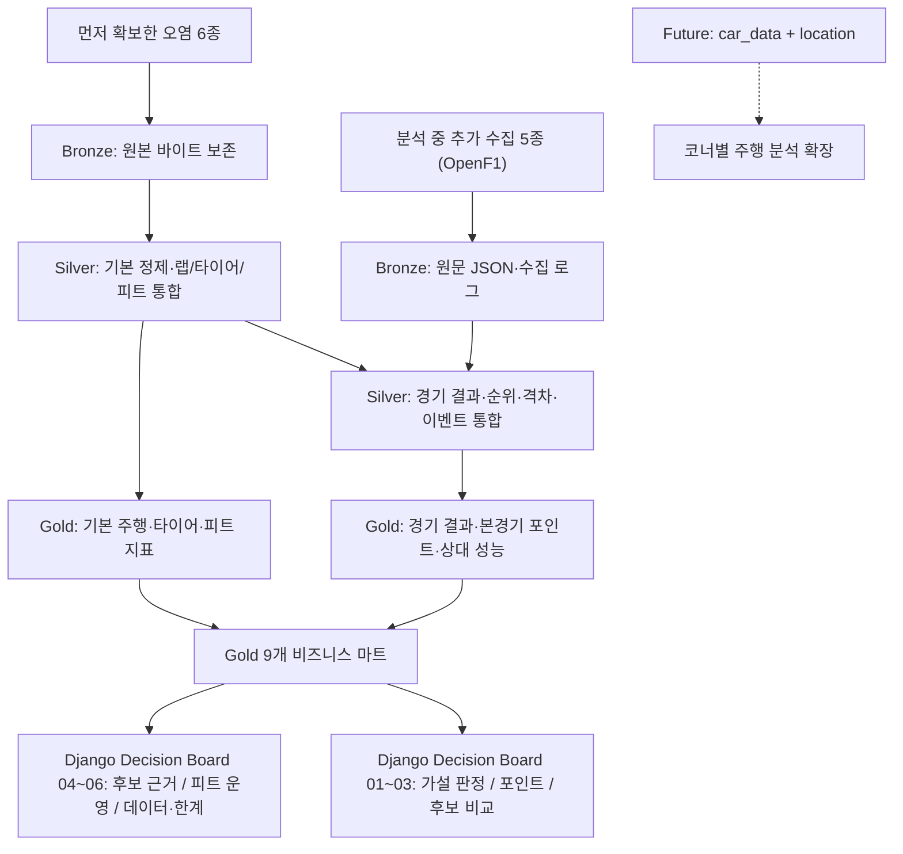

# F1 Team Builder Intelligence
## F1 경기 데이터 정제·분석 기반 드라이버·팀 특성 분석과 결과 해석 — 최종 통합 기획안

> **프로젝트 핵심 질문**  
> **“확보한 F1 경기 데이터를 정제·분석하면 드라이버와 팀의 특성과 차이를 어디까지 확인할 수 있으며, 그 결과가 드라이버 영입과 팀 운영에 어떤 시사점을 주는가?”**

> **진행 흐름**  
> **데이터 확인 → 정제·검증 → 탐색·비교 → (분석 중 부족한 근거를 보완하는) 추가 데이터 수집 → 결과에 근거한 결론 도출 → 의미 해석**  
> 이 프로젝트는 영입 결론을 먼저 정해 두고 데이터를 모은 것이 아니다. 먼저 확보한 오염 데이터 6종을 정제해 분석했고, 그 과정에서 6종만으로는 설명할 수 없는 부분(출발·최종 순위, 경기 중 순위·격차, 경기 통제 상황)을 보완하려고 추가 데이터 5종을 수집했다. 드라이버 영입과 팀 운영은 분석 결과를 해석해 시사점을 얻는 영역이다.

| 항목 | 최종 결정 |
|---|---|
| 문서 성격 | 제공된 V2 기획서를 기반으로, 이후 대화에서 확정한 분석 흐름과 결과 해석 방향을 통합한 실행용 기획안. 진행 현황은 [README.md](./README.md) 참고 |
| 기준일·관측 범위 | **2026-10-14** 기준, 2023년 OpenF1 제공 시작부터 해당 날짜까지 종료된 본경기(Race) |
| 원천 데이터 | **11종**: 먼저 확보한 오염 데이터 6종 + 분석 과정에서 추가 수집한 OpenF1 API 데이터 5종 |
| 수집하지 않는 데이터 | `championship_drivers`, `championship_teams`는 **현 단계에서 수집하지 않음** |
| 기술 구조 | **Bronze → Silver(기본 정제·심층 통합) → Gold 9개 마트 → Django** |
| 드라이버 평가 | **실제 기록·실제 단위 + 비교 집단 백분위(상위 %)**; 고정 100점 종합점수 제외 |
| 팀 분석 | 주행 약점, 팀별 피트 운영시간, 경기당 피트스톱 횟수·전략 성향 및 제약 |
| 성과 분석 | `session_result`의 **본경기 최종 결과 + 해당 시즌의 공식 본경기 기본 배점표**로 포인트 계산 |
| 결과 해석 | 분석 결과(드라이버·팀 특성, 실제 본경기 포인트·팀 경쟁력)를 바탕으로 팀·드라이버 조합의 시사점 도출 → 팀 배분금·스폰서십과의 관계에 대한 **정성적 해석** |
| 미래 확장 | `car_data` + `location` 기반 코너별 주행 분석, `championship_drivers` + `championship_teams` 기반 실제 챔피언십 성적 비교 (**현 범위 제외**) |
| 구현 목표 | **4일 MVP**, 확인 가능한 실측 지표와 공식 본경기 기본 포인트에 근거한 데모 |

---

## 1. 프로젝트 정의와 비즈니스 문제

### 1.1 출발점과 목적

출발점은 먼저 확보된 **세션·드라이버·랩·스틴트·기상·피트 데이터 6종**이다. 이 데이터는 오염된 상태로 주어졌으므로, 먼저 범위와 품질을 확인하고 정제·검증한 뒤 연결 가능한 기록에서 어떤 차이와 패턴이 나타나는지 살펴본다.

정제한 6종으로 랩 페이스·일관성·타이어 사용·피트 운영을 비교하다 보면, 그 차이가 **실제 경기 결과와 어떻게 이어지는지**, 순위 변화가 **경기 상황(SC/VSC·사고)** 때문인지는 6종만으로 설명하기 어렵다. 그래서 분석 과정에서 **출발 순위·경기 결과·주행 순위·경기 통제·격차 데이터 5종**을 추가로 수집해 비교와 해석의 근거를 보완한다.

본 프로젝트는 이렇게 정제·보완한 데이터를 Gold Layer 지표로 집계하고, **관찰된 결과에 근거해 결론을 도출**한다. 드라이버 영입과 팀 운영은 그 결론을 활용해 의미를 해석하는 영역이다. 선수의 페이스·일관성·타이어 사용 특성과 팀의 부족한 역량·피트 운영, 실제 본경기 포인트 경쟁 상황을 함께 보고 **어떤 조합이 팀의 보완점과 맞물리는지**, 성적이 **경제적 기회에 갖는 정성적 의미**는 무엇인지 검토한다.

### 1.2 분석으로 확인할 질문

1. **드라이버:** 팀 동료와 비교하면 얼마나 빠른가? 전체 드라이버 집단에서는 어떤 위치인가? 타이어를 오래 사용하면서 페이스를 유지하는가?
2. **팀:** 현재 주행 성능에서 부족한 영역은 무엇인가? 피트스톱 시간과 평균 횟수·스틴트 특성은 다른 팀과 어떻게 다른가?
3. **영입 조합:** 그 팀의 약점을 보완할 근거가 있는 후보는 누구인가? 해당 팀의 전략·피트 운영 환경에서 장점과 제약은 무엇인가?
4. **실제 성적:** 해당 팀과 드라이버가 본경기에서 획득한 기본 포인트는 얼마인가? 경쟁 팀과의 본경기 기본 포인트 격차는 어느 정도인가?
5. **비즈니스 가치:** 실제 본경기 기본 포인트를 기준으로 팀의 경쟁 위치는 어디인가? F1에서 시즌 성적이 팀 배분금과 스폰서십 기회에 갖는 의미는 무엇인가?

### 1.3 프로젝트가 주장하지 않는 것

- 특정 선수 영입으로 **포인트·순위·상금·스폰서 수익이 반드시 증가한다**는 인과적/확정적 예측.
- 영입 후 차량 적응, 계약 성사, 급여 및 계약 비용, 미래 승률에 대한 검증된 모델.
- 본경기 기본 포인트만으로 계산한 순위를 **공식 전체 컨스트럭터 챔피언십 순위**라고 표시하는 것.
- 피트레인 주행 시간을 크루의 순수 타이어 교체 작업시간과 동일시하는 것.
- 팀의 평균 피트스톱 횟수가 많다는 이유만으로 전략이나 피트크루 실력이 우수하다고 단정하는 것.
- 개별 정비사·엔지니어의 실력이나 선수와의 개인적 궁합을 평가·추천하는 것.

---

## 2. 분석 대상·데이터 수집 범위

### 2.1 기간·세션 정책

- **2023년~2026-10-14** 실제 완료된 `Race` 세션을 분석한다. 시작일은 OpenF1이 반환하는 첫 유효 세션을 기준으로 확인한다.
- `Qualifying`은 **`starting_grid` 수집을 위한 연결 세션**으로만 사용한다. Sprint 결과는 **현재 MVP 수집·포인트 범위에 포함하지 않는다**.
- 2026년 값은 시즌 최종 성적이 아닌 **2026-10-14 기준 누적 본경기 기본 포인트**로 표시한다.
- 데이터 미제공·부분 수집·오염으로 유효 비교 집단이 부족한 경기/드라이버는 `N/A`, 제외 이유와 커버리지를 함께 제공한다.
- 경기별 드라이버의 당시 소속팀을 기준으로 집계한다. 이적이 발생한 경우 과거 포인트를 새로운 팀에 소급 귀속하지 않는다.

### 2.2 먼저 확보한 오염 데이터 — 6종

| 데이터 | 대표 컬럼 | 핵심 용도 |
|---|---|---|
| `sessions` | `session_key`, `meeting_key`, `year`, `date_start`, `circuit_short_name` | 경기·시즌·서킷 기준 |
| `drivers` | `session_key`, `driver_number`, `full_name`, `team_name`, `name_acronym` | 드라이버·팀 소속 및 신원 매핑 |
| `laps` | `session_key`, `driver_number`, `lap_number`, `lap_duration`, `duration_sector_1~3`, `date_start` | 실제 랩·섹터 페이스 및 일관성 |
| `stints` | `session_key`, `driver_number`, `stint_number`, `compound`, `lap_start`, `lap_end`, `tyre_age_at_start` | 타이어 구간·페이스 변화 및 스틴트 길이 |
| `weather` | `session_key`, `date`, `track_temperature`, `air_temperature`, `rainfall` | 기상 조건 구분 및 비교 가능성 점검 |
| `pit` | `session_key`, `driver_number`, `lap_number`, `date`, `lane_duration`, `stop_duration` | 피트 이벤트·횟수·시간 및 팀 운영 분석 |

**기본 원칙:** 6종은 오염 데이터이므로 신뢰 가능한 값이라고 전제하지 않는다. 파일·인코딩·헤더·타입·결측·중복을 검사하고 Bronze 원본을 덮어쓰지 않는다.

### 2.3 분석 과정에서 추가 수집한 데이터 — 5종

6종을 정제해 탐색·비교하는 과정에서 **주행 지표의 차이가 실제 결과로 이어졌는지**, **순위·격차 변화가 경기 상황 때문인지**를 확인할 근거가 부족했다. 아래 5종은 이 공백을 보완하려고 OpenF1 API에서 추가로 수집했다.

| 데이터 | 대표 컬럼 | 보완하는 해석 |
|---|---|---|
| `starting_grid` | `session_key`, `driver_number`, `position` | 레이스 시작 순위 |
| `session_result` | `session_key`, `driver_number`, `position`, `dnf`, `dns`, `dsq`, `number_of_laps` | 최종 순위·완주 상태·**본경기 기본 포인트** |
| `position` | `session_key`, `driver_number`, `date`, `position` | 경기 중 순위 변화 타임라인 |
| `race_control` | `session_key`, `date`, `category`, `flag`, `lap_number`, `message` | SC/VSC·황기·사고 등 경기 맥락 |
| `intervals` | `session_key`, `driver_number`, `date`, `interval`, `gap_to_leader` | 상대 차량과의 격차 변화 |

**중요한 세션 매핑:** `starting_grid`는 2024 Bahrain GP 테스트에서 `meeting_key=1229`, **Qualifying `session_key=9468`**으로 조회됐고, 같은 GP Race 키 `9472`로 조회하면 404가 발생했다. 따라서 Qualifying 세션에서 수집한 `starting_grid`의 원본 키는 보존하고 **`meeting_key` + Qualifying↔Race 매핑 + `driver_number`**로 Race 결과에 연결한다. Sprint 주말·예선 명칭 예외는 검증·격리한다.

### 2.4 수집하지 않을 데이터와 이유

- **제외:** `championship_drivers`, `championship_teams`. 현재 의사결정에는 이미 수집할 `session_result`와 **공식 본경기 기본 배점표**로 계산하는 지표를 사용한다.
- **주의:** 본 프로젝트의 포인트 합계는 **Race 기본 배점에 한정한 재구성 값**이다. Sprint 점수, 2023~2024 패스티스트 랩 보너스, 단축/중단 경기의 예외 배점 및 각종 사후 정정이 반영되지 않은 결과를 공식 챔피언십 전체 점수라고 부르면 안 된다.
- **미래 확장만:** `car_data`, `location`. 현재의 11종 수집·Gold 9개 마트에 포함하지 않는다.

---

## 3. 전체 데이터 아키텍처



**단계 구분 원칙:** 발표에서는 **기본 분석(6종)** → **심층 분석(11종)**으로 설명한다. 6종 정제·분석 중 드러난 근거 부족을 보완하려고 데이터를 확장했다는 의미이며, Gold마다 `analysis_version=V1/V2`, `source_set=6/11`, `metric_version` 같은 **필수 이력 컬럼을 만들지 않는다**. 평가는 시즌·기준 시점, 비교 집단, 유효 표본 수, 결측·제외 사유를 중심으로 관리한다. 재실행 추적용 파이프라인 로그/매니페스트는 별도로 유지한다.

---

## 4. Bronze Layer — 원본 보존 및 데이터 수집 품질

- 6종 오염 소스의 원본 **파일 바이트·압축 구조·해시·파일명·추정 인코딩**을 보존한다. 자동수정은 복제한 Silver 입력에서만 수행한다.
- 5종 신규 소스는 **원본 응답 JSON**을 `year/meeting_key/session_key` 기준으로 저장하고, 원본 필드의 임의 삭제·수정 없이 필요하면 통합 CSV를 별도로 생성한다.
- 수집 매니페스트: `source_name`, `session_key`, `meeting_key`, HTTP 응답 상태, 수집 시각, 행 수, 재시도, 원본 경로/해시.
- `success_empty`, `not_available`, `rate_limited`, `request_failed`를 같은 결측으로 취급하지 않는다. `404`, `429`, 네트워크 실패를 구분한다.
- 중복 적재 방지, 세션 단위 재실행, 실패 항목 복구 및 커버리지 요약을 제공한다.

## 5. Silver Layer — 정제·관계 통합

### 5.1 기본 분석을 위한 정제(기존 6종)

- 파싱/인코딩/구분자/헤더·숫자·Boolean·UTC 날짜 정규화.
- `session_key`, `driver_number`, `lap_number` 등 키·참조·중복 검사.
- `lap_duration > 0`, 섹터 값 범위·합계 정합성 검사. 임의의 결측 보간을 하지 않는다.
- `laps`↔`stints`: `lap_number`가 스틴트 `lap_start~lap_end` 범위에 속하는지 확인하여 **범위 JOIN**.
- `weather`↔랩: 동일 Race의 시각 기준 **허용 오차가 있는 as-of JOIN**. 차이가 크거나 매칭 실패하면 표시.
- `pit`↔레이스/드라이버: 피트 이벤트 원형을 보존하고 해당 스틴트·랩과 연결한다.
- 정상 랩 분석에서는 피트 인/아웃 랩, 안전차 구간, 불가능한 기록을 제외하거나 태깅한다. `race_control`이 추가되면 그 기준을 보강한다.
- 오염 행은 **규칙ID·오류 유형·원본값·처리 방법(자동수정/격리/미해결)·처리 상태**를 보존한다.

### 5.2 심층 분석을 위한 통합(전체 11종)

- `starting_grid`: Qualifying 세션 → 같은 `meeting_key`의 대응 Race → 드라이버 매핑. Qualifying/Race `session_key`를 직접 동일 JOIN하지 않는다.
- `session_result`: Race × 드라이버의 최종 결과와 팀 소속·시즌을 결합한다.
- `position`/`intervals`: **시계열 이벤트**이므로 랩당 1행으로 가정하지 않는다. 시간 범위/허용 오차 as-of 매칭 또는 랩별 집계 후 결합한다.
- `race_control`: 경기 이벤트를 시간·랩 구간에 부착하여 사고·SC/VSC 영향 맥락을 구분한다.
- 날짜·팀 이름·드라이버 번호 변경/이적, 세션 경계, 포인트 집계 기준일을 명시한다.
- JOIN 전후 건수·고유키·미매칭률 검사로 잘못된 다대다 행 증폭을 방지한다.

**대표 Silver 산출물:** `silver_lap_performance`, `silver_driver_race`, `silver_pit_event`, `silver_position_timeline`, `silver_race_control_events`, `silver_team_membership`, `silver_quality_log`. 기존 기획안의 `silver_v1_*` 이름을 구현 편의상 유지해도 되지만 **최종 Gold는 9개 단일 마트 구성**을 원칙으로 한다.

---

## 6. Gold Layer — 9개 데이터 마트와 비즈니스 역할

Gold는 데이터 자체의 수집 이력을 복제하는 층이 아니라, **정제·보완한 데이터에서 실제 기록·비교 지표를 집계해 결론의 근거를 제공하고, 그 결론을 선수 영입·팀 운영 관점에서 해석할 수 있게 하는 계층**이다.

| 번호 | Gold 마트 | 기본 Grain(집계 단위) | 핵심 값·비즈니스 목적 |
|---:|---|---|---|
| 1 | `gold_driver_performance` | 시즌 × 드라이버 × 해당 팀 소속 구간 | 유효 랩 대표 페이스, 팀 동료 차이(초/랩), 전체 상대 페이스(%·상위 %), 일관성·섹터 |
| 2 | `gold_tyre_performance` | Race × 드라이버 × 스틴트 | 컴파운드, 유효 스틴트 길이, 타이어 사용에 따른 페이스 변화(초/랩), 새 타이어/후반 특성 |
| 3 | `gold_race_outcome` | Race × 드라이버 | 출발/최종 순위, 완주 상태, 해당 Race의 **본경기 기본 포인트**, 제외·규칙 근거 |
| 4 | `gold_pit_strategy` | Race × 드라이버 × 피트 이벤트 | 피트 이벤트 전후 랩·순위·격차, `lane_duration`/`stop_duration`, 이벤트 맥락; 경기당 횟수는 별도 집계 뷰 |
| 5 | `gold_driver_profile` | 평가 기준일 × 시즌 × 드라이버 × 필요 시 소속팀 구간 | 선수 개인 실측 기록 + 항목별 상위 % + 본경기 기본 포인트·표본 수 |
| 6 | `gold_team_profile` | 평가 기준일 × 시즌 × 팀 | 팀의 주행 약점, 경기당 피트 횟수·스틴트 성향, 본경기 기본 포인트 누계 및 **기본 포인트 기준 팀 순위** |
| 7 | `gold_team_pit_benchmark` | 시즌 × 팀 × 서킷 그룹 | 피트레인/정지시간 분포·중앙값·IQR·비교 팀 백분위·표본·가용성 |
| 8 | **`gold_driver_team_fit`** | 평가 기준일 × 대상 팀 × 영입 후보 × 교체 대상 자리 | 주행·전략 적합성, 팀 운영 제약, 관측 근거, **실제 본경기 포인트와 팀 경쟁 위치에 근거한 비즈니스 해석** |
| 9 | `gold_data_quality` | 실행 × 소스 × 오류/검증 규칙 | 정제/격리/커버리지/키·JOIN/포인트 검증 근거 |

> **구조 결정:** 이 9개를 유지한다. Race 포인트 전용 10번째 마트나 경제 가치 11번째 마트를 추가하지 않는다. 경기 포인트는 `gold_race_outcome`, 팀별 누적·순위는 `gold_team_profile`, 최종 의사결정 해석은 `gold_driver_team_fit`에서 책임진다.

### 6.1 드라이버 실측 지표 + 상위 백분위

| 지표 | 측정 단위/방향 | 비교 시 주의 |
|---|---|---|
| 팀 동료 대비 페이스 | `driver_median_lap_sec - teammate_median_lap_sec` **초/랩**; 음수면 더 빠름 | 동일 팀·동일 Race·유사 컴파운드/구간/조건에서 비교. 팀 동료가 없으면 N/A |
| 전체 드라이버 상대 페이스 | `100 × (driver_valid_pace / same_race_reference_pace - 1)` **%**; 낮을수록 상대적으로 빠름 | 경기마다 같은 조건의 기준 페이스 정의; 다른 서킷 절대 랩타임 직접 평균 금지 |
| 전체 대비 성능 위치 | 위 지표 등을 동일 시즌·유효 표본 집단에서 매긴 **상위 N%** | 지표별 우수 방향·비교 선수 수·집계 방법 표시. 측정 퍼센트와 백분위 구분 |
| 랩타임 일관성 | 정상 랩 `IQR` 또는 표준편차, **초**; 일반적으로 작을수록 안정적 | SC/VSC, 피트 전후, 교통·날씨·노면 차이 고려 |
| 타이어 페이스 유지 | 같은 스틴트에서 사용 랩 수 대비 랩타임 추세 **초/랩** | 고무 마모의 직접 측정값이 아님. 연료 감소/교통/날씨 혼재 |
| 경기 결과 | 순위 변화 **계단**, 완주율 **%**, Race 기본 포인트 **점** | 사고·페널티·차량 차이 포함; 순수 운전 실력으로 단정 금지 |

- **표시 원칙:** `실제값 → 비교 집단에서 상위 % → 유효 랩·경기 수 → 한계` 순서. 예: **팀 동료보다 -0.18초/랩**, 전체 상대 페이스 **상위 15%** (가상 예시).
- **백분위 표기:** 상위 %는 **'좋은 방향부터 순위를 매긴 상대 위치'**이며 성능 100점이 아니다. 비교 대상이 적으면 `n`을 표시하고 수치 해석을 제한한다.
- 차량 성능의 영향을 완전히 분리할 수 없으므로 **팀 동료 비교(비슷한 차량 맥락)**와 **전체 그리드 비교(절대 경쟁력의 근사)**를 함께 제공한다.
- 시즌 중 이적·결장, 유효 표본 수 미달은 집계 및 비교에서 정해진 기준으로 처리하고 사유를 노출한다.

### 6.2 팀·피트 운영·전략 지표

| 지표 | 권장 계산 | 해석 |
|---|---|---|
| 경기당 평균 피트스톱 횟수 | `정상적으로 출발하고 분석 가능한 드라이버-Race의 피트 이벤트 수 합 ÷ 대상 드라이버-Race 수` | 팀 전략 성향의 **기초 관측값**. 0회 피트인 기록도 분모에 포함 |
| 피트 횟수 분포 | 드라이버-Race별 0/1/2/3회 이상 비율 | 특정 횟수에 치우치는지 확인 |
| 평균/중앙 스틴트 길이 | 유효 스틴트 랩 수 분포 | 긴 스틴트를 선호/실행한 기록인지 확인 |
| 피트레인 소요시간 | `lane_duration` 중앙값·IQR, **초** | 피트레인 진입·주행·정지·출구 영향이 섞여 있음 |
| 실제 정지시간 근사 | **제공된 경기의** `stop_duration` 중앙값·IQR, **초** | `lane_duration`과 별도 비교, NULL을 0으로 보완 금지 |
| 피트 전후 변화 | 허용된 비교 창에서 랩·순위·차량 간 격차 변화 | 전략 효과의 **관측된 맥락**, 인과 효과로 단정 불가 |
| 운영 백분위 | 같은 시즌·서킷/유사 조건의 비교 팀 내 시간 분포 순위 | 표본 수·측정 가능 경기 차이를 반드시 노출 |

**주의:** 평균 피트 횟수는 팀의 순수한 '공격 성향'이 아니다. SC/VSC·우천·중도 리타이어·타이어 규정·경기 특수 규칙·서킷 조건에 크게 달라진다. 기본 비교는 **같은 경기/서킷**에서, 필요하면 건조 경기·완주자·그린 플래그 구간 등으로 범위를 좁혀 비교한다. 해당 조건을 구분할 데이터가 부족하면 '전략 성향'을 확정하지 않고 관측 횟수라고만 표시한다.

### 6.3 드라이버 × 팀 전략 적합성

이 절은 앞선 분석 결과를 해석하는 단계다. 드라이버 적합성은 **“실력이 좋은 선수를 뽑는다”**보다 **“분석에서 드러난 팀의 보완점을 어떤 후보의 관찰된 특성이 메울 수 있는가?”**에 초점을 둔다.

1. **대상 팀·평가 시즌·기준일 선택:** 소속 드라이버와 팀의 주행 약점, 팀의 본경기 기본 포인트 경쟁 위치를 확인한다.
2. **후보군 선정:** 유효 경기·랩·타이어 데이터가 충분한 선수만 비교한다. 계약/연봉/영입 가능성은 알 수 없다고 명시한다.
3. **선수 특성 검토:** 팀 동료 차이·전체 상대 페이스·일관성·타이어 페이스 유지·본경기 기본 포인트·완주 실적을 **실제 단위 + 항목별 상위 %**로 제공한다.
4. **팀 전략 환경 검토:** 팀의 경기당 평균 피트 횟수, 스틴트 길이, 피트 시간·일관성, 타이어 페이스 약점 등 확인.
5. **적합성 설명:** 예를 들어 **긴 스틴트 후반 페이스가 약한 팀**에는 **페이스 유지 지표가 우수한 후보**를 우선 검토한다. 새 타이어에서 빠른 후보라면 팀의 피트 손실·전략 여건을 함께 설명한다. 이는 *적합성 판단 근거*이지 자동적인 성적 개선 증명이 아니다.
6. **후보 비교:** 팀이 우선 개선할 지표를 선택하면 해당 지표 중심으로 후보를 우선 제시한다. 여러 지표가 상충하면 장단점을 나란히 표시한다. **고정 100점 점수·불투명한 가중합 점수는 사용하지 않는다.**
7. **출력:** 추천 근거, 표본·결측, 팀 운영 제약, 후보 선택 시 고려 사항, 해당 시즌 **실제 본경기 기본 포인트·팀 간 격차를 이용한 비즈니스 해석**.

**피트크루의 역할:** 대상 팀에 **현재 고정된 운영 환경**으로 취급하고 다른 팀의 피트 처리시간과 비교한다. 특정 크루를 영입 대상으로 추천하거나 선수와의 개인적 궁합을 계산하지 않는다. 또한 피트 정지시간(초)을 드라이버 랩 페이스(초/랩)에서 단순 차감하지 않는다.

---

## 7. 본경기 공식 기본 배점 기반 포인트 분석

### 7.1 무엇을 계산하는가

현재 원천 11종의 `session_result`에서 **실제 Race 최종 분류·순위**를 가져오고 해당 시즌 FIA/F1의 본경기 기본 배점 규칙을 적용해 **드라이버별/팀별 Race 기본 포인트**를 구한다.

| 본경기 최종 순위 | 1 | 2 | 3 | 4 | 5 | 6 | 7 | 8 | 9 | 10 |
|---|---:|---:|---:|---:|---:|---:|---:|---:|---:|---:|
| 기본 포인트 | **25** | **18** | **15** | **12** | **10** | **8** | **6** | **4** | **2** | **1** |

- 정상 배점 조건의 **1~10위만** 기본 포인트 획득; 11위 이하 0점. `DNS`, `DSQ`, 최종 미분류 및 배점 예외 경기 처리는 **공식 결과·규정으로 검증**한 뒤 계산한다.
- **`DNF`를 무조건 0점으로 처리하지 않는다.** 중도 리타이어했더라도 공식적으로 분류·포인트 자격이 주어진 예외가 있을 수 있으므로 최종 순위·분류 상태를 우선 확인한다.
- 단축·중단 레이스 등 일반 표준 배점이 아닌 경우는 **해당 연도 규정에 따라 별도 계산·검증**하거나 MVP에서 `excluded_nonstandard_points`와 이유를 표시한다. 잘못된 25-18-… 표준표를 기계적으로 적용하지 않는다.
- **2023~2024:** 최속 랩 보너스 1점이 있던 시즌이지만 MVP의 **기본 포인트 합계에서 제외**한다. 2025년부터 해당 보너스 규칙이 폐지됐다.
- **Sprint:** 현 수집 범위에서 제외하므로 Sprint 포인트도 제외한다.
- **결과 명칭:** `race_base_points`, `cumulative_race_base_points`, `race_base_points_team_rank` 등으로 표기하여 **공식 전체 챔피언십 점수·순위와 구분**한다.

### 7.2 데이터 마트별 집계

```text
gold_race_outcome (Race × driver)
  finish_position, classification_status, race_base_points,
  scoring_rule_year, points_rule_status, team_at_race
       |
       +--> gold_driver_profile: 드라이버 시즌 누적 본경기 기본 포인트
       |
       +--> gold_team_profile: 해당 Race 당시 팀에 귀속된 두 차량 등의
              기본 포인트 합산 → 시즌 누적 → 본경기 기본 포인트 기준 팀 순위
```

- 동일 드라이버의 시즌 중 팀 이적은 Race 당시 소속팀으로 점수를 귀속한다.
- 동점인 팀이 있으면 **'기본 포인트 동률'**로 표시하거나, 별도로 검증된 타이브레이커 규정에 따라 처리한다. 단순 합계만으로 공식 순위를 확정하지 않는다.
- 실제 공식 시즌 포인트 전체를 재현한다고 주장하지 않고, **동일 범위의 본경기 기본 포인트 비교**에 사용한다.

### 7.3 계산 품질검사

- 정상 배점 Race에 대해 드라이버 최종 순위·팀 소속·포인트 함수 테스트.
- 하나의 Race에 `driver_number` 중복/팀 이력 충돌이 있는지 검증.
- Sprint, 보너스, 배점 예외 경기 **제외 상태와 이유** 보고.
- 매 경기 드라이버 포인트 합과 팀 합계의 일치 검증(동일 포함 집단 기준).
- 공신력 있는 공개 경기 결과와 표본 경기의 점수 계산을 대조하고 차이는 `gold_data_quality`에 남긴다.

---

## 8. 최종 Business Impact — 설득력 있는 해석의 경계

### 8.1 무엇을 '사실'로 보여줄 것인가

**관측·검증된 사실**
- 선택 팀의 실제 유효 랩 페이스·타이어 페이스·피트 운영시간/횟수.
- 후보 드라이버의 실제 상대 성능, 해당 비교 집단 상위 %, 당시 시즌 **실제 본경기 기본 포인트**.
- 분석 범위의 팀별 **누적 본경기 기본 포인트와 팀 간 격차**.

**해석·비교에 해당하는 것**
- 현재 팀이 부족한 지표와 후보의 강점이 얼마나 맞물리는가.
- 후보에게 유리하거나 불리할 수 있는 피트 전략·운영 조건은 무엇인가.

**분석 결과의 한계**
- 후보 영입 이후의 미래 포인트·순위·우승 확률은 계산하거나 예측하지 않는다.
- 실제 팀 배분금과 스폰서 계약액은 현재 데이터로 산출할 수 없다.
- 본경기 기본 포인트 기준 팀 순위는 Sprint·일부 보너스·예외 배점이 제외되어 **공식 컨스트럭터 챔피언십 전체 순위와 다를 수 있다**.

### 8.2 경제적 가치에 대한 문서화 원칙

**팀 배분금 관점:** F1 팀은 컨스트럭터 챔피언십 성적 등을 반영하는 수익 배분 구조를 가진다. 특히 최근 협약에서는 이전 시즌 순위 외에 장기 성과 및 역사적 지위 등도 고려된다. 따라서 **좋은 시즌 성적은 더 유리한 팀 배분금의 기회로 이어질 수 있다**고 설명한다. **한 계단 상승 = 정해진 금액 증가**로 단순 환산하지 않는다.

**스폰서십 관점:** 팀의 성적과 노출·브랜드 매력은 스폰서 계약 관심 및 협상에 긍정적 영향을 줄 수 있다. 단, **성과 상승 = 특정 금액 또는 계약 확정**은 아니다. 스타성·시장·기존 계약·파트너십 등 추가 요인을 고려해야 한다.

**현재 Gold의 비즈니스 산출물:** `실제 본경기 기본 포인트·팀 간 격차 + 팀 약점·후보 강점 + 팀 피트 운영 제약 + 배분금/스폰서십 기회(정성)`.

**현재 계산하지 않는 값:** 팀별 실제 지급 상금, 드라이버 계약 비용, 순수익, 스폰서 계약액, 수익률(ROI). 재무 데이터가 확보된다면 별도 확장 단계에서 검토한다.

### 8.3 최종 Business Impact 리포트 양식

| 영역 | 대시보드에 보여줄 값 | 표현 방식 |
|---|---|---|
| 대상 팀 | 시즌, 현재 드라이버 구성, 본경기 기본 포인트·경쟁 팀과의 격차 | 실측·공식 배점 산출 |
| 후보 드라이버 | 팀 동료 페이스 초/랩, 전체 페이스 %·상위 %, 타이어 유지·일관성, 실제 Race 기본 포인트 | 원 단위 + 백분위 |
| 전략 적합성 | 팀 경기당 피트 횟수, 스틴트 길이, 피트 시간과 후보 특성 | 근거와 제한점 함께 설명 |
| 후보 검토 의견 | 우리 팀의 어떤 약점을 보완하는가, 어떤 운영 제약이 있는가 | 설명 가능한 규칙 기반 |
| 비즈니스 함의 | 시즌 성적 개선과 팀 배분금·스폰서십 기회의 연결 | **정성적 해석**, 금액 예측 아님 |
| 신뢰성 | 평가 시점·표본 수·누락·비교 집단·배점 예외 | 품질 근거·N/A 표시 |

**최종 해석 문장 예시(수치 미포함·설명용):**

> “선택 팀은 장기 스틴트 후반의 상대 페이스 유지가 약하고, 후보 A는 비교 가능한 경기에서 해당 지표가 우수하다. 팀의 평균 피트 횟수·피트 처리시간을 함께 보면 후보를 영입 검토할 근거가 있다. 이 팀의 기존 시즌 본경기 기본 포인트와 경쟁 팀과의 격차도 함께 제시하여 현재 경쟁 위치를 이해할 수 있다. F1에서 컨스트럭터 성적은 팀 배분금 및 스폰서십 기회와 관련이 있지만, **이 후보의 영입이 향후 포인트·순위를 올릴 것이라고 예측하거나 실제 수익 금액을 산출하지는 않는다.**”

---

## 9. Django 서비스 화면 설계 — Decision Board

여러 화면으로 나누지 않고 **한 페이지 Decision Board**로 구성한다. 상단에서 조건을 고르면 아래 섹션 01~06이 같은 조건으로 다시 계산되며, 섹션 순서가 곧 **가설 → 관측 결과 → 판단 → 시사점**의 읽는 순서다. 화면 구현은 `web/dashboard/templates/dashboard/decision_board.html`(경로 `/`)이다.

### 9.1 상단 — 질문과 분석 조건

| 구성 | 내용 |
|---|---|
| 헤드라인 | “어떤 조합을, 어떤 근거로 검토할까?” — 영입 결론이 아니라 근거를 검토하는 화면임을 먼저 밝힌다 |
| 조건 툴바 | **관측 시즌**, **분석할 팀**, **비교 기준 선수**(영입 검토 자리), **후보 정렬 기준**(필드 상대 페이스·동료 대비 페이스·조건 보정 일관성·타이어 잔차 추세·본경기 기본 포인트), **후보 소속 범위**(타 팀 전체·본경기 포인트 4위 밖·상위 4팀) |
| 바로가기 칩 | 전체 팀·선수 선택, 실제 성적·실적 비교, 11가지 조건 안정성, 종합 검토 판정 |

### 9.2 본문 섹션

| 번호 | 섹션 | 핵심 출력 | 연결 Gold |
|---|---|---|---|
| **01** | **처음 생각 vs 데이터 결과** | 가설 6개(팀 진단·타이어·라인업·피트 운영·포인트·결론의 안정성)를 각각 **O 관측값과 일치 / X 다름 / ? 판단 보류**로 판정. 카드마다 핵심 수치 2개, 팀별 막대 비교, 표본 수, “그래서 …” 해석 문장 | 1, 2, 4, 5, 6 |
| **02** | **포인트와 경제적 의미** | 시즌 팀별 본경기 기본 포인트 막대, 선택 팀의 기본 포인트 순위와 앞뒤 팀과의 격차, ±10점 경쟁 구간 해석, 배분금·스폰서십 기회의 **정성적** 설명과 제외 범위 | 3, 6 |
| **03** | **영입 후보 비교** | 기준 선수를 첫 칸에 고정하고 후보 카드에 전체 페이스·팀 동료 대비·일관성·타이어 유지·포인트·완주/출발을 **실제 값 + 상위 %**로 표시. 기준 선수보다 좋은 값은 ✓, 표본 부족은 N/A, 1차 검토 조건 충족 여부 표시. 점수 합산 없음 | 5, 8 |
| **04** | **후보 검토 근거** | 선택한 후보 → 대상 팀에 대해 세 질문으로 판정: ① 같은 경기끼리 비교해도 빠른가 ② 정제 조건 11가지·시즌 전후반을 바꿔도 유지되는가 ③ 자기 팀 동료와 비교해도 빠른가. 결론 한 줄, “그래서 지금 할 일”, 펼쳐보기 상세 근거 | 1, 8 |
| **05** | **팀별 피트 운영 비교** | 전체 팀 표: 피트레인 상대 차이·피트레인 시간·정지시간·정지시간 차이·1초 초과 비율·경기당 피트·스틴트 길이·비교 이벤트(칸마다 표본 수). 선택 팀의 경기당 피트 횟수 분포(0/1/2/3회 이상, 0회 포함) | 4, 7 |
| **06** | **데이터와 한계** | Bronze 11종 → Silver 비교 가능한 관측 → Gold 9개 마트 흐름, 랩 단계별 건수(원천→정제 통과→참조 연결→비교), 데이터셋별 행 수·연결 Race·화면에서의 역할, 남은 자료 문제와 제외 처리, 판단할 때 꼭 알아둘 한계 | 9 |

### 9.3 보조 패널

| 패널 | 내용 |
|---|---|
| 그래서 무엇을 할까? | 현재 선택에서 다음에 확인할 일 |
| 지금 선택한 데이터 범위 | 시즌·팀·기준 선수·후보 범위와 표본 |
| 화면 읽는 순서 | 01 → 06 읽는 순서 안내 |

### 9.4 보조 화면

| 경로 | 화면 | 용도 |
|---|---|---|
| `/data/` | 적재 테이블 조회 | MySQL에 적재된 원천·정규화 테이블을 그대로 조회해 화면 수치의 출처를 확인 |
| `/gold/` | 이전 시안 (C, Gold 기반) | 기존 Decision Board 시안 보관용 |

**화면 원칙:** 고정 100점 점수나 불투명한 가중합을 만들지 않고, 모든 판정에 표본 수와 판단 보류(?·N/A)를 함께 보여준다. 인터랙티브 금액 계산기나 확정적 경기 결과 예측은 만들지 않는다.

---

## 10. 개발 일정 — 4일 MVP

| 일정 | 수행 작업 | 최소 성공 결과 |
|---|---|---|
| **Day 1 — 정제·기본 분석** | 오염 6종 확인·Bronze 보존·품질 프로파일링·Silver 기본 JOIN·유효 랩/스틴트·피트 이벤트 생성, 기본 지표 탐색 | 정제 로그, `silver_lap_performance`, 기본 성능 지표 검증, 6종만으로 설명되지 않는 질문 정리 |
| **Day 2 — 추가 수집·포인트** | Day 1에서 드러난 공백을 보완할 5종 수집, Qualifying `starting_grid`↔Race 매핑, Silver 심층 통합, 공식 기본 배점 함수, 정상배점 Race 포인트 검증 | Race 결과·드라이버 포인트·팀 기본 포인트 집계, 데이터 커버리지 |
| **Day 3 — Gold 집계·결론 도출** | 9개 Gold 마트 핵심 필드 완성, 팀 동료/전체 비교 백분위, 팀 평균 피트 횟수·피트 벤치마크, 관찰 결과에 근거한 결론 정리 | 실측값 기반 드라이버 프로필, 팀별 특성·차이, 결과에 근거한 결론 |
| **Day 4 — 해석·서비스·발표** | 결론을 영입·팀 운영 관점에서 해석(적합성 규칙), Django Decision Board 최종 화면, 실제 본경기 포인트 및 팀 간 격차 시각화, 경제적 가치의 정성적 해석, 검증/예외/문서·발표 준비 | 데이터 → 결론 → 시사점(팀 선택 → 후보 비교 → 포인트 경쟁력·비즈니스 함의) 최종 데모 |

### 10.1 개발량 조절 원칙

- 전 경기를 무리하게 채우기보다 **완전하게 검증된 시즌·경기 우선**으로 MVP를 시연하고 전체 커버리지 미달을 명시한다.
- 포인트 계산이 간단해도 **예외 경기·팀 귀속·동률·Sprint 제외**가 틀리면 결론이 왜곡되므로 먼저 테스트한다.
- 백분위는 선수 수가 적고 차량 영향이 크다. 대표 지표 몇 개를 정확하게 계산하는 것을 우선한다.
- 재무 데이터 없이 상금·스폰서 금액을 꾸며내지 않는다. 경제적 기회는 문장과 근거로만 표현한다.
- 공식 챔피언십 포인트를 보여주려면 Sprint/보너스/예외 규정이 필요하므로, MVP 명칭을 **일관되게 '본경기 기본 포인트 기준'**으로 유지한다.

---

## 11. 데이터 품질 및 검수 체크리스트

- [ ] Bronze에서 원본 바이트/JSON·해시/수집 상태 추적 가능
- [ ] 오염 탐지·자동수정·격리·미해결 상태 구분 가능
- [ ] `session_key`/`meeting_key`/`driver_number`와 팀 소속 시점 매핑 검증
- [ ] Qualifying `starting_grid`와 Race `session_result`의 키 매핑 오류 없음
- [ ] 시간 as-of JOIN과 스틴트 범위 JOIN의 유효 매칭률·중복/행 증폭 점검
- [ ] 유효 랩·SC/VSC·피트 전후 제외 기준 명시
- [ ] 팀 동료 대비 값/전체 상대 %/상위 %의 기준 집단·지표 방향·표본 수 명시
- [ ] 0회 피트 대상 포함, 출발하지 않은 레이스·DNF 처리 정책 명시
- [ ] `lane_duration`/`stop_duration` **분리**, 결측 0 대체 금지
- [ ] 표준배점 본경기 1~10위 포인트 함수 테스트, DNS/DSQ/DNF·단축경기 예외 검사
- [ ] 2023~2024 최속 랩 보너스, Sprint 미포함 표시 및 공식 전체 챔피언십과 구분
- [ ] 같은 포함 집단의 드라이버 포인트 합계 == 팀 포인트 합계
- [ ] 후속 기간 자료를 사용한 과거 시점 추천 등 미래 정보 유출 금지
- [ ] 후보의 과거 포인트를 영입 대상 팀에 그대로 더하는 계산 금지
- [ ] 비즈니스 결론은 **관측 기록 / 영입 적합성 해석 / 경제적 기회에 대한 정성적 설명**으로 분리 표시
- [ ] 예시 값은 '가상 예시' 레이블 부착, 사실처럼 제시하지 않음

**선택 검증(여유가 있을 때):** 과거 특정 평가 시점까지의 데이터로 드라이버 지표를 산출해 이후 실제 성과와 탐색적으로 비교한다. 이는 평가 지표의 관련성을 살피는 테스트이지, **선수 이적의 인과 효과를 검증하는 백테스트가 아니다**.

---

## 12. Future Roadmap — `car_data` + `location` + Championship Data

현재 MVP에서는 추가 수집하지 않는다. 발표 마지막에 **주행 특성의 정밀 분석과 공식 챔피언십 성적 분석으로 확장할 수 있는 가능성**을 제시한다.

| 확장 데이터 | 관련 필드 | 추가로 가능한 분석 |
|---|---|---|
| `car_data` | `speed`, `throttle`, `brake`, `rpm`, `n_gear`, `drs`, `date` | 가감속, 제동·스로틀 전환, 기어/RPM·DRS 주행 패턴 |
| `location` | `x`, `y`, `z`, `date` | 차량 위치·코너 구간 식별과 궤적 추정 |
| 두 데이터 결합 | 시각 동기화·서킷 구간 매핑 | 코너 진입 속도·최저 속도·탈출 가속·브레이킹 패턴 비교 |
| `championship_drivers` | `driver_number`, `points_start`, `points_current`, `position_start`, `position_current` | 드라이버별 실제 챔피언십 누적 포인트 및 순위 변화 분석 |
| `championship_teams` | `team_name`, `points_start`, `points_current`, `position_start`, `position_current` | 팀별 실제 컨스트럭터 챔피언십 누적 포인트 및 순위 변화 분석 |

### 12.1 Car Data + Location 기반 정밀 주행 분석

- 확장 시 원본 적재 → 시간·샘플링 품질 검증 → 코너 영역 정의 → 위치/차량 상태 시간 매칭 → `silver_car_telemetry` → `gold_driving_style` 등을 검토한다.
- `car_data`와 `location`의 시각/주기가 다르면 동기화 오차를 평가한다. 위치 정합성이 낮으면 코너 단위 비교를 주장하지 않는다.
- 차량·타이어·교통·연료 등 외부 영향 때문에 이를 **드라이버 개인의 순수 운전 능력**으로 과해석하지 않는다.

### 12.2 Championship Data 기반 실제 시즌 성적 분석

- 현재 MVP에서는 `session_result`와 공식 본경기 기본 배점 규칙을 활용하여 **드라이버별·팀별 본경기 기본 포인트**를 계산한다.
- 향후 `championship_drivers`와 `championship_teams`를 추가하면 **Sprint 포인트 및 시즌별 보너스 규칙 등이 반영된 챔피언십 누적 포인트와 실제 순위**를 확인하고, 기존 본경기 기본 포인트 분석과 비교할 수 있다.
- 이를 통해 선수의 실제 시즌 경쟁력과 팀의 컨스트럭터 챔피언십 성적을 보다 정확하게 분석하고, 팀 경쟁력 개선과 경제적 가치 사이의 관계를 구체화할 수 있다.
- 챔피언십 포인트와 순위는 **실제 과거 성적을 분석하는 근거**이며, 특정 선수 영입 이후의 미래 포인트나 상금 증가를 확정적으로 예측하는 용도로 사용하지 않는다.

**향후 확장 방향:** 현재의 **랩·섹터·경기 결과 중심 분석**에서 코너별 정밀 주행 분석과 실제 챔피언십 성적 검증으로 확장하여, 드라이버와 팀의 조합을 더욱 폭넓은 데이터로 평가할 수 있는 시스템으로 발전시킨다.
---

## 13. 최종 납품 산출물

1. **Bronze 원본 11종**, API 수집 매니페스트, 원본/응답·압축·인코딩 보존.
2. **Silver 정제·통합 테이블**, 오염 탐지·격리 기록, 팀·세션/시각/스틴트 매핑 규칙.
3. **Gold 9개 마트**, 실측 지표·백분위·팀 전략·본경기 기본 포인트 계산 정의서.
4. **공식 본경기 기본 배점 룰 테이블/함수**와 표준배점/예외 경기 검증 테스트.
5. **Django Decision Board**(한 페이지): 처음 생각 vs 데이터 결과, 포인트와 경제적 의미, 영입 후보 비교, 후보 검토 근거, 팀별 피트 운영 비교, 데이터와 한계 + 적재 테이블 조회(`/data/`).
6. **최종 영입 검토 리포트**: 후보와 팀의 적합성 + 운영 제약 + 실제 본경기 포인트·팀 간 격차 + 배분금·스폰서십 기회의 정성적 의미.
7. **4일 재실행 절차·테스트·품질 리포트·발표 자료**.
8. **미래 확장 설계**: `car_data`·`location` 기반 코너별 주행 분석과 `championship_drivers`·`championship_teams` 기반 공식 시즌 성적 비교(실제 구현 제외).

---

## 14. 발표용 최종 스토리라인

1. **데이터에서 출발:** 먼저 확보한 오염 데이터 6종(세션·드라이버·랩·스틴트·기상·피트)의 범위와 품질을 확인했다.
2. **정제·검증:** 원본을 보존한 채 오염을 탐지·복구·격리하고, 같은 기준(VC01~VC71)으로 pandas와 MySQL에서 검증해 신뢰 가능한 랩·타이어·피트 데이터를 만들었다.
3. **탐색·비교와 한계 발견:** 정제한 6종으로 페이스·일관성·타이어·피트를 비교하자, 그 차이가 실제 결과와 어떻게 이어지는지, 순위 변화가 경기 상황 때문인지는 설명할 수 없었다.
4. **추가 데이터 수집:** 이 공백을 보완하려고 출발 순위·경기 결과·주행 순위·경기 통제·격차 5종을 추가 수집해 11종으로 연결했다.
5. **결과에 근거한 결론:** 드라이버 지표를 **팀 동료 대비 + 전체 상대 백분위**로, 팀의 주행 약점·피트 횟수·스틴트 길이·피트 운영시간을 비교하고, 공식 본경기 기본 배점으로 실제 포인트·팀 간 격차를 확인해 결론을 도출했다.
6. **의미 해석 — Team Builder:** 도출한 결론을 바탕으로 팀의 보완점과 후보 드라이버의 관찰된 특성이 어떻게 맞물리는지 해석했다.
7. **의미 해석 — Business Impact:** **실제 성적과 팀 배분금·스폰서십 기회의 관계**를 정성적으로 설명했다.
8. **Future:** `car_data`·`location` 기반 코너별 주행 분석과 Championship Data 기반 실제 시즌 포인트·순위 비교로 확장할 수 있다.

### 발표 결론(권장 문구)

> **“저희 프로젝트는 확보한 F1 경기 데이터를 정제·검증하고, 분석 과정에서 부족한 근거를 추가 데이터로 보완해 드라이버의 실측 주행 성능과 팀의 피트·타이어 운영 특성을 비교했습니다. 공식 본경기 기본 배점으로 드라이버·팀의 실제 포인트 경쟁력을 확인해 결론을 도출했고, 그 결과가 드라이버 영입·팀 운영과 팀 배분금·스폰서십 기회에 주는 시사점을 해석했습니다.”**

> **설명 범위의 한계:** MVP가 계산하는 것은 **본경기 기본 포인트 기준 성적**이며 공식 전체 시즌 챔피언십 순위, 영입 후 성적 확정 예측, 실제 상금·스폰서 수익 추정이 아니다.

---

## 15. 공식 출처 및 구현 참고

- **OpenF1 API 문서:** https://openf1.org/docs/ — 원천 엔드포인트·필드와 제공 범위 검증.
- **F1 공식 포인트 제도 설명:** https://www.formula1.com/en/latest/article/how-many-world-championship-titles-would-f1-drivers-have-won-using-the.182RC42vohx8STIpJR5o26 — 본경기 기본 1~10위 배점, Sprint 및 역사적 보너스 설명.
- **F1 공식 2025 규칙 변경 안내:** https://www.formula1.com/en/latest/article/from-fastest-lap-to-increased-rookie-running-7-rule-changes-you-need-to-know.pgdSMDnDyv1aJUgtcKPp6 — 2025년부터 패스티스트 랩 보너스 폐지.
- **FIA 시즌별 스포츠 규정:** https://www.fia.com/regulation/category/110 — 시즌별 공식 배점, 단축·중단 및 분류 예외의 확인 근거.
- **Liberty Media 2025 Form 10-K(2026 발행):** https://www.sec.gov/Archives/edgar/data/1560385/000110465926020653/lmca-20251231x10k.htm — 2026 Concorde Agreement의 팀 배분금 및 팀 상업 수익 설명. 팀별 지급금과 스폰서 계약액을 이 자료만으로 추정할 수는 없다.
- **데이터 수집·해석에 대한 중요 전제:** API 제공 범위, 2023~2026 모든 Race의 응답 완전성, 예외 경기 배점과 최종 분류는 **수집·검수 과정에서 실제 응답 및 공식 기록으로 확인한다**. 본 기획서는 구현 전에 이미 검증되었다고 주장하지 않는다.
