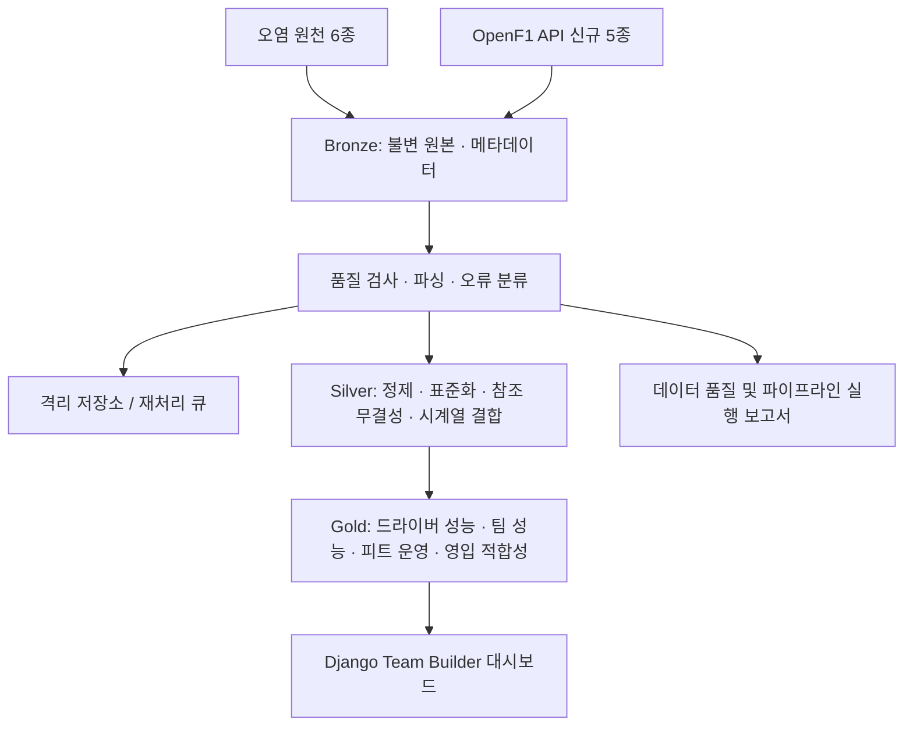

# F1 Team Builder Intelligence
## 데이터 기반 드라이버 영입 및 피트크루 운영 역량 의사결정 지원 시스템 — 최종 프로젝트 명세서

| 항목 | 내용 |
|---|---|
| 문서 버전 | 1.0 (최종 단일 기획) |
| 기준일 | 2026-10-14 |
| 분석 대상 | OpenF1 공개 데이터의 2023년 최초 제공 시점~2026-10-14에 완료된 F1 본경기(Race) |
| 원천 데이터 | 11종 (기확보 오염 데이터 6종 + API 추가 수집 5종) |
| 기술 방향 | Bronze → Silver → Gold 데이터 파이프라인, Python·SQL, Django 시각화 |
| 핵심 사용자 | F1 팀 운영 책임자·스카우팅 및 전략 분석 담당자 |
| 최종 산출물 | 드라이버 영입 후보 비교 + 팀 단위 피트크루 운영 벤치마킹 대시보드 |

> **핵심 비즈니스 질문:** "우리 팀의 현재 약점을 데이터로 진단했을 때, 어떤 드라이버를 우선 영입 검토하고 피트크루 운영의 어떤 부분을 개선해야 경기 경쟁력을 높일 수 있을까?"

## 1. 프로젝트 개요

F1 공개 레이스 기록을 검증 가능한 성능·운영 지표로 변환하여, 특정 팀의 **드라이버 영입 후보**를 비교하고 **팀 단위 피트크루 성과**를 벤치마킹하는 의사결정 지원 시스템을 구현한다. 정제 전 데이터에 포함된 다양한 오염을 자동 탐지·정제·격리하고, 추가 원천 정보를 수집하여 주행 기록과 실제 경기 결과를 연결한다.

**본 프로젝트가 제공하는 것**
1. 드라이버별 상대 페이스·일관성·타이어 사용 구간 성과·완주 실적.
2. 팀별 상대 성능과 개선 필요 영역.
3. 팀별 피트스톱 운영 성과 및 타 팀 대비 격차.
4. 선택한 팀과 후보 드라이버의 **조건부 적합성 순위**, 근거, 표본 수, 불확실성.
5. 오염 데이터 정제 전후 품질 및 처리 이력.

**하지 않는 것**
- 미래 우승을 보장하는 예측, 영입 이후 실제 성적의 확정적 인과 추정.
- OpenF1에 개인별 피트크루 작업·인사 기록이 없으므로 **개별 엔지니어·크루 인력 영입 추천**.
- 피트레인 체류시간을 크루의 순수 타이어 교체 작업시간과 동일시하는 비교.

## 2. 분석 범위 및 수집 기준

- **기간:** 2023년 공개 데이터의 실제 최초 세션부터 기준일 2026-10-14까지. 2026-10-14 이후 예정 경기 제외.
- **경기:** `session_name=Race`의 종료된 본경기만. 연습/예선/스프린트는 기본 분석에서 제외.
- **대상:** 수집에 성공했고 필요한 키가 유효한 드라이버·팀·경기 기록. 부족한 커버리지는 데이터 가용성 리포트로 공개.
- **기간의 정확한 시작:** '2023년 3월'을 고정값으로 가정하지 않고 OpenF1 API의 실제 응답을 기준으로 결정.
- **데이터 소스:** https://openf1.org/docs/ ; 세션 조회 `https://api.openf1.org/v1/sessions?year=2023&session_name=Race`.
- **관측 시점:** 팀·드라이버 평가는 명시한 기준 시즌 및 그 이전 데이터만 사용해 미래 정보 유출을 방지.

## 3. 원천 데이터 명세 — 11종

### 3.1 오염 데이터 정제 대상 — 6종 (확보 완료)

| 데이터 | 핵심 필드 예 | 역할 |
|---|---|---|
| `sessions` | `session_key`, `meeting_key`, `year`, `date_start`, `circuit_short_name` | 세션·연도·서킷 기준정보 |
| `drivers` | `session_key`, `driver_number`, `full_name`, `team_name`, `name_acronym` | 경기별 드라이버·소속팀 관계 |
| `laps` | `session_key`, `driver_number`, `lap_number`, `lap_duration`, `duration_sector_1~3`, `date_start` | 랩/섹터 성능·안정성 |
| `stints` | `session_key`, `driver_number`, `stint_number`, `compound`, `lap_start`, `lap_end`, `tyre_age_at_start` | 타이어 사용 구간·페이스 변화 |
| `weather` | `session_key`, `date`, `track_temperature`, `air_temperature`, `rainfall` | 기상 조건 |
| `pit` | `session_key`, `driver_number`, `lap_number`, `date`, `lane_duration`, `stop_duration` | 피트스톱 이벤트·운영 시간 |

기확보 데이터는 **오염 데이터**이므로 신뢰 가능한 값이라고 전제하지 않는다. 기간·세션 수·컬럼 존재 여부·실제 행 수는 초기 프로파일링에서 확인한다. Bronze에는 원본 바이트를 보존하고, 원본 자체를 덮어쓰지 않는다.

### 3.2 새롭게 API 수집할 데이터 — 5종

| 데이터 | 핵심 필드 예 | 역할 |
|---|---|---|
| `starting_grid` | `session_key`, `driver_number`, `position` | 공식 출발 순위 |
| `session_result` | `session_key`, `driver_number`, `position`, `dnf`, `dns`, `dsq`, `number_of_laps` | 최종 결과·완주 상태 |
| `position` | `session_key`, `driver_number`, `date`, `position` | 경기 중 순위 타임라인 |
| `race_control` | `session_key`, `date`, `category`, `flag`, `lap_number`, `message` | 사고·세이프티카·황기 등 맥락 |
| `intervals` | `session_key`, `driver_number`, `date`, `interval`, `gap_to_leader` | 경쟁 차량 간 격차 변화 |

수집은 연도별 종료 Race 목록을 기준으로 `session_key` 단위로 수행한다. API 응답은 원문 그대로 Bronze에 저장하고, 수집 성공·빈 결과·미제공·요청 실패를 구분한다. API 항목의 실제 제공 범위와 필드 형식은 세션별 응답을 기준으로 검사한다.

> **피트크루 데이터 주의:** `lane_duration`은 피트레인 전체 이동을 포함하며, `stop_duration`은 실제 정지시간에 가까운 지표다. `stop_duration`은 모든 시즌·경기에서 일관되게 제공되지 않을 수 있으므로, NULL을 0으로 채우지 않고 가용 세션에서만 별도 비교한다.

## 4. 데이터 파이프라인 아키텍처



### 4.1 Bronze — 원본 보존 및 추적성
- 원본 CSV/응답을 변경 없이 보관한다. 예: `bronze/{source}/{year}/{session_key}/{ingested_at}/...`.
- 파일/응답별 체크섬, 원천, 수집 시각, `session_key`, 인코딩 감지 결과, 행 수·크기, 상태를 매니페스트에 기록한다.
- 오염된 파일이 읽히지 않아도 Bronze에서 삭제하지 않고 오류 유형을 남긴다.
- 요청 제한·타임아웃 재시도, 성공한 세션 재수집 방지, 실패 재시도 절차를 둔다.

### 4.2 Silver — 정제·표준화·통합

**핵심 품질 규칙**
- CSV 파싱/인코딩/구분자/헤더 오류 분류, 날짜 UTC 통일, 숫자·불리언 타입 변환.
- 필수 키 결측·중복 검사, `session_key`·드라이버 참조 무결성 확인.
- `lap_duration > 0`, 섹터시간 양수 및 합계와 전체 랩타임의 합리적 일치 여부 검사.
- 스틴트의 `lap_start ≤ lap_end`, 같은 드라이버의 스틴트 구간 중복 검사.
- 관측치 단위가 다른 날씨·순위·격차는 세션·드라이버 키와 시간 조건으로 정렬해 결합.
- 시간 초과·미매칭·충돌 기록은 **원본값/오류 사유/조치/재처리 여부**를 함께 격리.
- 파싱 불가 값·결측은 임의 보정하지 않는다. 수정 가능한 규칙과 복구 불가능한 레코드를 분리한다.

**대표 Silver 테이블**
| 테이블 | Grain(한 행의 의미) | JOIN 규칙 |
|---|---|---|
| `silver_lap_performance` | 세션 × 드라이버 × 랩 | laps + stints(랩 범위), weather(시간 기준) |
| `silver_driver_race` | 세션 × 드라이버 | sessions + drivers + grid + result |
| `silver_pit_event` | 세션 × 드라이버 × 피트 이벤트 | pit + 관련 랩·스틴트 |
| `silver_position_timeline` | 세션 × 드라이버 × 관측 시각 | position + intervals, 적절한 시간 오차 제한 |
| `silver_race_control_events` | 세션 × 이벤트 | race_control 정규화·이벤트 식별 |
| `silver_team_membership` | 세션 × 드라이버 | 당시 소속 팀, 시즌 중 이적·팀 명칭 변경 반영 |

**주의:** `position` 및 `intervals`의 시점은 랩과 일대일이 아니다. 직접 동등 JOIN하지 않고, 랩 시작·종료 구간과 관측시각을 기준으로 이벤트 매핑한다. 필요하면 최근 이전 값(as-of)을 제한된 허용 오차 내에서 사용한다.

### 4.3 Gold — Business-Ready Data
- 사용자가 곧바로 의사결정에 활용할 수 있는 **정의가 고정된 집계 데이터 마트**를 작성한다.
- 모든 점수는 산식 버전·대상 기간·비교 모집단·유효 표본 수·결측률·제외 규칙을 포함한다.
- 지표와 추천 결과는 사전 계산 및 갱신하도록 하고, Django는 준비된 Gold를 주로 조회한다.

## 5. Gold 데이터 마트 명세

| 데이터 마트 | Grain | 핵심 지표 및 이용 목적 |
|---|---|---|
| `gold_driver_performance` | 시즌 × 드라이버 × 팀 구간 | 동일 경기 내 상대 페이스, 유효 랩 수, 섹터 성능, 주행 일관성 |
| `gold_tyre_performance` | 세션 × 드라이버 × 스틴트 | 컴파운드, 타이어 사용량, 정상 랩 초기/후반 페이스, 변화 기울기 |
| `gold_race_outcome` | 세션 × 드라이버 | 출발·최종 순위, 포지션 증감, 완주/DNF/DNS/DSQ |
| `gold_pit_strategy` | 세션 × 드라이버 × 피트 이벤트 | 피트 전후 페이스·격차·순위 및 당시 이벤트 상황 |
| `gold_driver_profile` | 평가 시점 × 드라이버 | 조건 표준화된 상대 페이스·일관성·타이어 페이스 유지·완주 지표 |
| `gold_team_profile` | 시즌 × 팀 | 팀 상대 성능, 드라이버 구성, 타이어·전략 약점, 데이터 커버리지 |
| `gold_team_pit_benchmark` | 시즌 × 팀 | 피트레인 체류시간 분포, 실제 정지시간 가용 표본의 중앙값·분산, 운영 추세 |
| `gold_driver_team_fit` | 평가 시점 × 대상 팀 × 후보 드라이버 × 모델 버전 | 팀 약점과 후보 장점의 적합성, 시나리오 점수·근거·신뢰도 |
| `gold_data_quality` | 실행 × 데이터셋 × 오류유형 | 입력 수, 적합·정제·격리 수, 오류·복구율, 원천 커버리지 |

### 5.1 드라이버 성능 프로파일 정의
- **페이스:** 같은 경기·비슷한 조건 및 팀 동료 대비 랩타임 편차(초/랩); 서킷 간 절대 랩타임 평균 비교 금지.
- **일관성:** 유효 랩의 변동성. 안전차·피트 입출구·이상 레코드 제외를 동일하게 적용.
- **타이어:** 스틴트 내 관측 페이스 변화. 연료량·교통·노면의 혼재 영향을 명시하고 타이어의 순수 마모 효과라고 주장하지 않음.
- **결과:** 출발 위치 대비 순위 변화, 완주율. 차량·사고·패널티 영향을 설명하며 드라이버 개인의 절대 실력으로 해석하지 않음.
- 시즌 중 팀 이적 시 팀별 기간을 구분하고 이후 시즌별 통합 규칙을 문서화한다.

### 5.2 팀별 피트크루 벤치마킹 정의
- 팀별 피트 이벤트 수, `lane_duration` 중앙값·사분위범위·상위 분위·이상치 비중을 제공한다.
- `stop_duration`이 실제로 제공된 세션에 한해 정지시간 분포를 **별도** 계산한다.
- 동일 서킷 또는 비슷한 조건 내 상대 비교를 우선하며 팀 간 레이스 수·연도별 가용 표본 차이를 표시한다.
- 결과는 팀 차원의 **운영 역량 개선 및 벤치마킹** 자료다. 특정 정비사·엔지니어 개인의 기여, 채용 적합성은 산출하지 않는다.

### 5.3 영입 후보 추천 알고리즘 (설명 가능한 규칙 기반 MVP)
1. **대상 팀 선택:** 시즌·분석 시점, 현재 팀 구성 및 약점 지표를 조회한다.
2. **후보군 정의:** 데이터가 충분한 드라이버 중 조건에 부합하는 후보를 선택한다. 계약 상태·영입 가능성은 외부 데이터가 없으면 판단하지 않는다.
3. **상대 지표 정규화:** 비교 가능한 경기/조건/평가 기간을 기준으로 페이스·일관성·타이어·결과 지표를 동일 방향의 0~100 점수로 환산한다.
4. **팀 약점 가중치:** 대상 팀에 맞춰 가중치를 설정하거나 사용자가 직접 조절한다. 예시: `score = 0.35*pace + 0.25*consistency + 0.25*tyre + 0.15*outcome`.
5. **추천 결과:** 후보별 점수 및 순위, 약점 보완 이유, 원 지표, 포함 경기 수, 데이터 커버리지, 모델 버전, 가중치 변화에 따른 순위 민감도를 함께 제공한다.
6. **판정 제외:** 최소 경기·랩 수 미달 또는 핵심 지표 부재 시 `not_evaluable`; 결측을 0점으로 대체하지 않는다.

**해석 한계:** 점수는 사용자 지정 기준에 따른 **후보 비교 지수**이며 계약 가능성, 차량 적응, 미래 승수·우승 확률 또는 채용 효과를 검증한 예측 모델이 아니다.

## 6. Django 화면 및 사용자 흐름

| 화면 | 사용자 입력 | 제공 결과 |
|---|---|---|
| Overview | 시즌·경기·팀 | 시즌 성적, 기본 팀 현황, 데이터 커버리지 |
| Driver Analytics | 선수 1~2명, 시즌 | 상대 페이스·타이어·일관성·경기 성과 비교 |
| Team Diagnostics | 팀·시즌 | 강점/약점, 동종 조건 대비 성과, 근거 표본 |
| Pit Crew Benchmark | 팀·시즌·서킷 | 팀별 피트 처리시간 분포, 추세, 가용 데이터 범위 |
| **Team Builder** | 영입 대상 팀·후보·평가 가중치 | 영입 후보 순위, 적합 사유, 증거 지표, 민감도 |
| Data Quality | 배치·데이터셋 | 오염 탐지·복구·격리 현황, 실행 상태 |

**핵심 데모 시나리오:**
1. 2025년을 선택하고 특정 팀의 성능 프로파일을 확인한다.
2. 해당 팀이 평균 상대 페이스보다 타이어 사용 후반의 페이스 유지에서 취약한지 조사한다.
3. 후보 드라이버를 비교하고 타이어 관련 가중치를 조절한다.
4. 추천 결과 변화와 근거·불확실성을 확인한다.
5. 별도 피트크루 화면에서 같은 팀의 운영 시간이 경쟁 팀과 어떻게 다른지 본다.

## 7. 재현성·운영 설계

**실행 작업 단위**
```text
01_profile_corrupted_sources
02_ingest_bronze
03_validate_and_quarantine
04_build_silver_core
05_collect_openf1_extensions
06_build_silver_extensions
07_build_gold_driver_and_team
08_build_gold_pit_benchmark
09_build_gold_team_fit
10_run_quality_and_publish
```

- **멱등성:** 동일 원천과 실행 버전으로 중복 행을 생성하지 않음. 원본 체크섬과 자연키/고유키 관리.
- **증분 처리:** 세션 단위 신규/변경 감지 후 필요한 Silver·Gold만 갱신.
- **로그:** 실행 시작/종료, 입출력 행 수, 오류율, 재시도 횟수, 성공/실패 사유.
- **검증 실패:** 품질 기준 초과 시 Gold 게시 중단 또는 해당 세션 제외; 기존 정상 결과 유지.
- **보존:** Bronze 원본, 격리 파일, 검증 결과, Gold 산식 버전, 생성 시점 기록.
- **오케스트레이션:** 4일 MVP는 Python CLI/Makefile 스크립트와 의존성 순서 관리로 구현 가능. 필요 시 Airflow/Prefect로 확장.

## 8. 품질 및 검수 기준

| 항목 | 합격 기준 |
|---|---|
| 원본 추적성 | Gold 지표에서 원본 세션·파일과 정제 규칙 확인 가능 |
| 키 무결성 | Gold 기준 중복 Grain 0건, 중요한 FK 오류 격리 및 보고 |
| 파이프라인 재실행 | 같은 입력 재실행 시 결과 중복 없음 |
| 시계열 결합 | JOIN 방식·허용 오차·미매칭 건수 기록 |
| 오염 정제 | 발견/자동 수정/격리/미해결 건수 구분 가능 |
| 팀·드라이버 비교 | 같은 기준 기간·조건에서 계산, 표본 수 제공 |
| 피트크루 분석 | `lane_duration`과 `stop_duration` 분리, 커버리지 표시 |
| 추천 투명성 | 점수 산식·가중치·근거·제외 및 불확실성 표시 |
| 서비스 | Django에서 팀 선택 → 진단 → 후보 비교 → 피트 벤치마킹 완료 |

## 9. 개발 일정 — 4일 MVP

| 일정 | 우선 구현 |
|---|---|
| Day 1 | 원천 6종 프로파일링, Bronze 저장, 오염 검사/격리 규칙, Silver 핵심 키 정제 |
| Day 2 | 랩·스틴트·날씨 통합, 신규 5종 세션별 API 수집, Silver 확장 |
| Day 3 | 성능·결과·피트·팀 데이터 마트, 적합성 점수, 품질 검증 |
| Day 4 | Django Team Builder 및 Pit Benchmark 화면, 샘플 검증·문서화·시연 |

**범위 축소 우선순위:** 전체 경기 분석을 목표로 하지만 처리량·API 가용성에 문제가 생기면 완성된 경기부터 세션 단위로 게시한다. 먼저 핵심 드라이버·팀 프로파일과 팀 피트 벤치마킹, 설명 가능한 후보 비교를 완성한다. 복잡한 인과 예측 및 개인 엔지니어 분석은 범위 밖이다.

## 10. 최종 납품 산출물

1. Bronze 원본 저장소와 수집·무결성 매니페스트.
2. 오염 데이터 정제·격리 스크립트와 정제 전후 품질 보고서.
3. Silver 표준화 테이블, JOIN 규칙 및 데이터 사전.
4. Gold 비즈니스 지표 테이블과 추천 점수 정의서.
5. Django 웹 대시보드(팀 진단·드라이버 영입 후보·피트크루 벤치마킹).
6. 재실행 가능한 파이프라인 스크립트와 실행 로그, 검증 테스트.
7. 발표 자료용 대표 사례: **팀의 약점 → 후보 평가 → 피트 운영 개선 → 최종 권고**.

## 11. 발표용 핵심 메시지

> **"2023~2026년 F1 공개 데이터를 기반으로 오염된 주행 기록을 정제하고, 레이스 운영·결과 데이터를 결합해 팀과 드라이버의 상대 성능을 분석했다. 이를 팀별 드라이버 영입 후보 비교와 피트크루 운영 역량 벤치마킹이라는 실제 의사결정에 활용할 수 있는 Gold 데이터 마트로 제공한다."**

**프로젝트 성공의 기준은 단순히 점수나 그래프를 만드는 것이 아니라**, 팀 운영 책임자가 *어떤 데이터를 근거로 어느 후보를 우선 검토하고 어느 운영 역량을 개선할지* 설명할 수 있게 하는 것이다.

## 12. 공식 참조

- OpenF1 API: https://openf1.org/docs/
- 데이터 최초 제공 시점 및 세션별 커버리지: 각 연도 `sessions?year=YYYY&session_name=Race` 결과 확인.
- 엔드포인트별 속성·시즌 가용성: 실제 API 응답의 필드와 빈값을 기준으로 검수.

