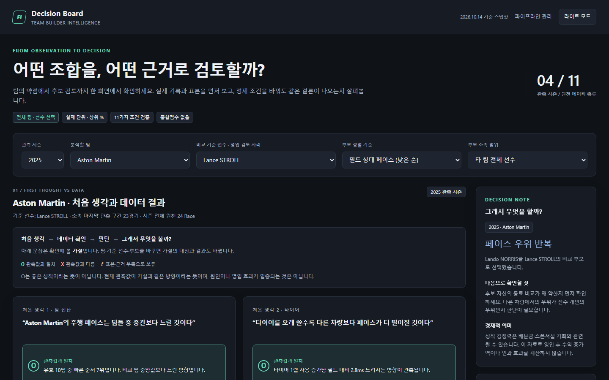

# F1 Team Builder Intelligence

F1 경기 데이터를 정제·분석해 드라이버와 팀의 특성을 파악하고, 드라이버 영입과 팀 운영 개선에 필요한 근거를 제시하는 프로젝트입니다.

이 문서는 **현재 저장소의 코드와 저장된 실행 결과**를 기준으로 진행 상황을 정리합니다. 전체 기획은 [F1_P2_Spec.md](./F1_P2_Spec.md)에 있습니다.

> **발표자료:** [F1 Team Builder 데이터 분석 보고 (PPT, 26장)](./docs/F1_TeamBuilder_발표자료.pptx) — 결론(1순위 RUSSELL) → 한 장 요약 → ① 숫자를 믿을 수 있게(5종 추가 이유 포함) → ② 우리 팀은 어디가 약한가 → ③ 누가 그 약점을 메울 수 있나 → ④ 무엇을 할 것인가 → 한계 · 부록(재현 방법)

## 🏁 핵심 기능: 우리 팀에 맞는 드라이버 찾기

> **“가장 빠른 선수가 아니라, 우리 팀의 약점을 메울 선수를 데이터로 찾는다.”**

**Decision Board**는 팀을 고르면 그 팀의 약점을 데이터로 진단하고, 그 약점을 메울 수 있는 타 팀 드라이버를 **근거와 함께 좁혀 가는** 화면입니다. 결론을 대신 내리는 추천기가 아니라, 영입 판단에 필요한 근거를 순서대로 보여 주는 의사결정 지원 도구입니다.

| 단계 | 화면에서 보는 것 | 분석하는 데이터 |
|---|---|---|
| ① 팀 진단 | 페이스·타이어·라인업·피트·포인트·결론 안정성 가설을 **O(관측과 일치) / X(다름) / ?(보류)** 로 판정 | 랩·스틴트·피트·경기 결과 |
| ② 포인트 경쟁 | 시즌 팀별 본경기 기본 포인트, 앞뒤 팀과의 격차, 접전 구간 | session_result + 공식 기본 배점 |
| ③ 후보 비교 | 전체 페이스·팀 동료 대비·일관성·타이어 유지·포인트를 **점수 합산 없이** 실제 값과 상위 %로 비교 | 시즌 × 드라이버 프로필 |
| ④ 후보 검토 근거 | ① 같은 경기끼리 비교해도 빠른가 ② 정제 조건 11가지·시즌 전후반에도 유지되나 ③ 자기 팀 동료와 비교해도 빠른가 | 공통 경기 비교·재표집·조건별 민감도 |
| ⑤ 피트 운영 | 피트레인·정지시간 차이, 1초 초과 비율, 경기당 피트 횟수 분포 | pit·stints |
| ⑥ 데이터와 한계 | Bronze → Silver → Gold 흐름, 남은 자료 문제, 해석의 경계 | 원천 11종 커버리지·품질 |

**사례 — 2025 Aston Martin (비교 기준 Lance STROLL 자리)**

- **팀 진단**: 필드 상대 페이스 10팀 중 **7위(+0.46%)**, 피트레인 시간이 같은 경기 타 팀보다 **+0.28초**
- **포인트**: 본경기 기본 포인트 **7위 · 80점**, 6~9위 4팀이 18점 안의 접전
- **결론**: 타 팀 후보 19명 중 7명이 기준 선수보다 빨랐고, 자기 팀 동료 대비 우위까지 모든 조건(11/11)에서 반복된 것은 **George RUSSELL(1순위)·Charles LECLERC(2순위)** 두 명
  - RUSSELL: 기준 선수 대비 −1.03%p, 동료 대비 −0.138초/랩, 일관성 상위 10% · LECLERC: −1.12%p, 동료 대비 −0.202초/랩, 단 타이어 유지 하위(상위 95%)
  - 가장 빠른 NORRIS·VERSTAPPEN·PIASTRI는 자기 팀 동료 대비 우위가 반복되지 않아 차량 이점을 배제하지 못함
- **전체 스크리닝**: 2023~2026 팀 자리 × 타 팀 후보 **1,824개 조합** 중 가장 엄격한 판정(동료 비교까지 반복)은 **88건(4.8%)** — 빠르다는 이유만으로 추천하지 않는 보수적 기준

> 화면 데이터는 MySQL Gold 테이블(`gold_board_*`, [sql/06](./sql/06_create_gold_board.sql))에서 읽습니다. 관측된 차이를 영입 효과나 수익 증가로 단정하지 않으며, 본경기 기본 포인트는 공식 챔피언십 점수가 아닙니다.

## 저장소 구성

| 경로 | 내용 | 실행·안내 |
|---|---|---|
| `pipeline/` | 정제·검증 패키지: 추가 데이터 압축 해제(`extra_data`), 오염 6종 진단·복구(`recovery`), 정제 후 검증 VC01~VC71(`validate_cleaned`), 표준사전 PDF(`dictionary_pdf`) | `python -m pipeline.recovery` · [pipeline/README.md](./pipeline/README.md) |
| `sql/` | MySQL 스테이징 → 검증 → 정규화 스키마 적재 (01~05) → Decision Board Gold 테이블 (06) | [web/README.md](./web/README.md) |
| `web/` | Django: `dashboard`(Decision Board·Gold), `viewer`(적재 테이블 조회), `ops`(파이프라인 실행·오류 분석·정합성 관리자 `/ops/`) | `run_web.bat` · [web/README.md](./web/README.md) |
| `tests/` | `pipeline` 테스트 | `python -m unittest discover -s tests -v` |
| `data/` | 데이터 전체 — 메달리온 단계별 폴더 (아래 표) | |
| `logs/` | 관리자 화면 실행 로그 (`ops_runs/`, git 제외) | |
| `docs/` · `design/` | 데이터셋 상세 문서 · [발표자료](./docs/F1_TeamBuilder_발표자료.pptx) · 화면 디자인 시안 | |
| `F1_P2_Spec.md` | 최종 기획서 | |

#### `data/` 단계별 구성

| 폴더 | 단계 | 내용 | 만드는 곳 |
|---|---|---|---|
| `01_raw/` | Bronze · 원본 (수정 금지) | `F1_distribution.zip`(오염 6종 + 명세·체크섬, 파이프라인이 zip을 직접 읽음), `f1_extra_data.zip`(추가 5종) | 받은 그대로 보관. `f1_extra_data/`는 실행 시 자동 압축 해제(git 제외) |
| `02_reference/` | 기준표 | `standard_dictionary/`(표준사전·진단코드·검증 규칙), `schema/`(데이터 명세서·TO-BE 설계) | 사람이 관리 |
| `03_cleaned/` | Silver · 정제 결과 | `repaired/`(전체 행 + 복구 이력 컬럼), `quarantine/`(격리 행) | `python -m pipeline.recovery` |
| `04_reports/` | 품질·검증 리포트 | `quality/`([품질 리포트](./data/04_reports/quality/quality_report.md)·이슈·복구 이력), `validation/`([검증 리포트](./data/04_reports/validation/validation_report.md), VC01~VC71) | `pipeline.recovery` · `pipeline.validate_cleaned` |
| `05_gold/` | Gold 내보내기 | `decision_board.json` → MySQL `gold_board_*` 적재 원천 | 분석 결과 (적재: `manage.py load_board_gold`) |

### 서비스 실행

1. `run_web.bat` 실행 → http://127.0.0.1:8000 (Decision Board) · `/data/` (적재 테이블 조회) · `/ops/` (파이프라인 관리자). 서버는 하나, 포트도 8000 하나입니다.
2. `/ops/`는 관리자 계정이 필요합니다. 기본 계정은 없으며 PC마다 한 번 만듭니다: `venv\Scripts\python.exe web\manage.py createsuperuser`
3. 처음 설치(venv·`.env`·DB 생성)와 계정 관리는 [web/README.md](./web/README.md)를 따릅니다.

## 1. 데이터에서 출발한 분석 방향

### 분석의 출발점과 목적

출발점은 먼저 확보된 **세션·드라이버·랩·스틴트·기상·피트 데이터 6종**과 추가로 선정된 **출발 순위·경기 결과·주행 순위·경기 통제·격차 데이터 5종**입니다. 먼저 각 데이터의 범위와 품질을 확인하고, 연결 가능한 기록에서 어떤 차이와 패턴이 나타나는지 살펴봅니다.

분석은 **데이터 확인 → 정제·검증 → 탐색·비교 → 결과에 근거한 결론 도출 → 의미 해석**의 순서로 진행합니다. 개인 랩타임, 팀 동료 대비 페이스·일관성, 타이어 사용 특성, 피트 운영과 본경기 기본 포인트를 비교하되, 실제 데이터 커버리지와 비교 조건을 확인한 뒤 분석 질문과 결론의 범위를 구체화합니다.

드라이버 영입과 팀 운영은 분석 결과를 활용해 의미를 해석할 수 있는 영역입니다. 관찰된 차이가 팀의 보완점이나 후보 비교에 어떤 시사점을 주는지 검토하며, 성적과 팀 배분금·스폰서십 기회의 관계는 확보한 경기 데이터로 직접 확인할 수 있는 범위를 구분해 정성적으로 논의합니다.

### 데이터 구성과 현재 진행 범위

| 구분 | 데이터 | 진행 상태 |
|---|---|---|
| 오염 데이터 6종 | `sessions`, `drivers`, `laps`, `stints`, `weather`, `pit` | 진단·복구 파이프라인 구현 및 결과 생성 |
| 추가 데이터 5종 | `starting_grid`, `session_result`, `position`, `race_control`, `intervals` | [압축 파일](./data/01_raw/f1_extra_data.zip) 확보, 검증·적재 코드 작성 |
| 표준화·검증 | 표준사전, 진단코드, 정제 후 검증 항목 | CSV 기준표와 pandas·SQL 검사 코드 작성 |
| DB 연계 | MySQL 스테이징·정규화 스키마·적재 SQL | 설계 및 스크립트 작성, 실제 DB 실행 결과는 별도 확인 필요 |
| 분석·서비스 | Gold 9개 마트, Django, 드라이버 비교·팀 추천 | 기획 및 HTML 화면 시안 작성, 최종 구현은 후속 단계 |

기획상 분석 범위는 **2023년부터 2026-10-14까지 종료된 본경기(Race)**입니다. 실제 수집 범위와 분석 가능 경기는 데이터 커버리지 검증으로 확정해야 합니다. 데이터 선정 범위는 본경기 기본 데이터를 기준으로 정했습니다.

추가 5종은 기본 6종에 출발 조건, 최종 결과, 경기 중 순위·격차, 경기 통제 상황을 연결해 비교와 해석의 근거를 보완합니다. 데이터별 보완 내용은 [원본 데이터셋 문서](./docs/01_원본데이터셋.md#추가-데이터-5종의-역할)에 정리했습니다.

## 2. 데이터셋 요약

데이터셋 세부 내용은 `docs/`의 문서 4개로 나눴습니다. 이 절에는 대표 내용만 적습니다.

### 2.1 원본 데이터셋

- **오염 데이터 6종**(`sessions`, `drivers`, `laps`, `stints`, `weather`, `pit`, 총 120,873행)과 **미오염 추가 데이터 5종**(`starting_grid`, `session_result`, `position`, `race_control`, `intervals`)으로 구성됩니다.
- 세션은 `session_key`, 드라이버는 `session_key + driver_number`로 연결합니다. 예선 기준인 `starting_grid`는 `meeting_key`로 Race 세션에 매핑합니다.
- 오염 유형은 결측·이상치·값 오류·불일치·값 뒤바뀜·형식 오류·참조 위반·중복 8가지이며, 진단코드 `DQ001~DQ027`로 관리합니다.

자세히: [01_원본데이터셋.md](./docs/01_원본데이터셋.md) · [11종 데이터 명세서](./data/02_reference/schema/F1_데이터_명세서.md) · [배포 폴더](./data/01_raw/F1_distribution.zip)

### 2.2 데이터 사전

- 표준단어·표준용어·도메인·코드·컬럼사전·진단 기준·검증 기준·배점 기준·조합 규칙 9개 기준표로 11종의 컬럼 의미를 통일했습니다.
- 원본 값은 문자열로 보존하고 계산할 때만 숫자·일시로 해석합니다. 시간 길이는 초, 일시는 UTC 기준입니다.
- 본경기 기본 포인트는 25-18-15-12-10-8-6-4-2-1을 적용합니다. 원천 포인트의 패스티스트 랩 보너스는 분리해 관리합니다.

자세히: [02_데이터사전.md](./docs/02_데이터사전.md) · [표준사전 README](./data/02_reference/standard_dictionary/README.md) · [TO-BE 모델](./data/02_reference/schema/TO_BE_model_design.md)

### 2.3 데이터 정제 후

- [pipeline/recovery.py](./pipeline/recovery.py) v0.2.0(실행 ID `3d8d8eebc0fc`)이 원본 보존·구조 검증 → 진단·복구 → 격리·재검증 순서로 처리합니다.
- 품질 이슈 28,052건을 탐지해 1,335셀을 근거 기반으로 복구했고, 24,824건은 원천 특성으로 허용했습니다. 미해결 1,893건은 검토 대상, 2행은 격리했습니다.
- 결측은 일괄 대체하지 않으므로 분석할 때 지표별 유효 표본 수와 제외 기준을 함께 확인해야 합니다.

자세히: [03_정제결과.md](./docs/03_정제결과.md) · [품질 리포트](./data/04_reports/quality/quality_report.md) (HTML판: `quality_report.html`)

### 2.4 데이터 검증

- 정제 결과와 추가 데이터를 같은 기준(VC01~VC71)으로 pandas와 MySQL SQL에서 검사합니다. 두 결과는 일치합니다.
- 151개 검사 결과는 FAIL 0, PASS 124, WARN 7, INFO 20입니다.
- 행 수 대사: 원본 120,873행 = 변경 없음 119,579 + 복구 1,292 + 격리 2 + 제거 0.

자세히: [04_데이터검증.md](./docs/04_데이터검증.md) · [validate_cleaned.py](./pipeline/validate_cleaned.py) · [sql/](./sql/) · [웹·DB 실행 안내](./web/README.md)

## 3. 후속 분석: 관찰할 지표와 결과의 해석 방향

아래 항목은 앞으로 탐색할 분석 방향입니다. 지표를 집계한 뒤 차이의 크기와 경기 조건을 확인하고, 관찰된 결과가 뒷받침하는 범위에서 결론과 시사점을 정리합니다.

| 분석 영역 | 관찰할 데이터·지표 | 결과를 바탕으로 해석할 내용 | 현재 상태 |
|---|---|---|---|
| 드라이버 비교 | 유효 랩 페이스·일관성, 팀 동료 대비 차이, 비교 집단 백분위 | 비교 조건 안에서 나타나는 드라이버별 주행 특성과 차이 | 기획·정제 기반 준비 |
| 타이어 사용 | 컴파운드별 스틴트 길이, 타이어 사용에 따른 페이스 변화 | 타이어 사용 양상과 페이스 변화의 관계, 경기 조건에 따른 차이 | 경계 정제 완료, 통합·집계 후속 |
| 팀 피트 운영 | 경기당 피트 횟수, 레인 체류시간과 정지시간 분포 | 팀별 운영 양상과 시간 편차, 추가 검토가 필요한 기록 | 정제·격리 및 DB 스키마 준비 |
| 실제 성적 | 출발·최종 순위, 본경기 기본 포인트, 팀 간 격차 | 순위 변화와 포인트 분포에서 드러나는 경쟁 양상 | 추가 데이터·배점표·검증 코드·SQL 뷰 준비 |
| 결과의 활용 | 앞선 분석에서 확인한 드라이버·팀별 특성과 차이 | 후보 비교·팀 운영의 시사점과 적용 한계, 경제적 기회에 대한 정성적 논의 | 분석 결론 도출 후 검토, Gold·서비스 구현 후속 |

후속 결과는 **사용 데이터와 비교 조건 → 관찰된 패턴·수치 → 도출한 결론 → 의미와 한계** 순서로 기록합니다. 관찰된 관계를 인과관계나 영입 효과로 단정하지 않고, 차이가 뚜렷하지 않은 결과도 함께 남깁니다. 드라이버 순위·추천 결과·영입 효과에 대한 확정 수치는 아직 없으며, 화면 시안은 [design/index.html](./design/index.html)에 있습니다. 서비스에 반영할 내용도 실제 분석 결과를 확인한 뒤 구체화합니다.
