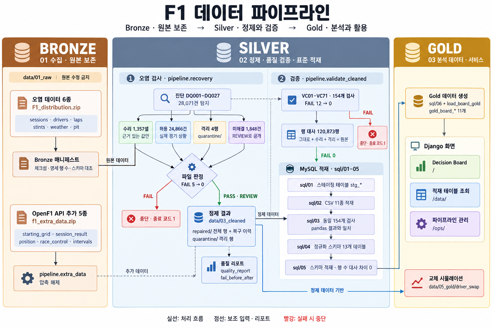
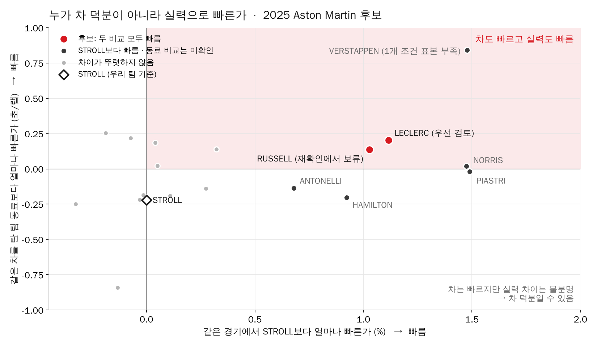
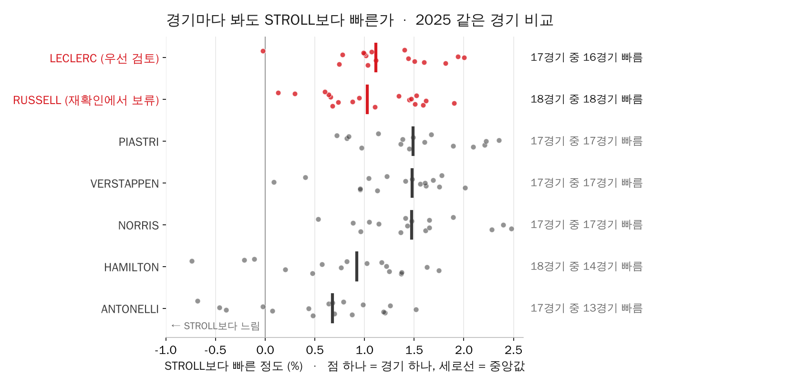

# F1 Team Builder Intelligence

**어떤 드라이버가 우리 팀의 약점을 메울 수 있는가.** 오염 데이터 6종과 분석 중 추가한 5종, 2023 ~ 2026-10-14에 끝난 본경기 87경기를 정제·검증해 직접 분석한 프로젝트입니다.

이 README는 [발표자료(PPT, 29장)](./docs/F1_TeamBuilder_발표자료.pptx)와 큰 순서가 같습니다(③ 안에서는 README가 선정 기준표를 먼저 둡니다). **결론 → 한 장 요약 → 전체 흐름(수집 → 적재) → ① 숫자를 믿을 수 있게 → ② 우리 팀은 어디가 약한가 → ③ 누가 메울 수 있나(+ 교체하면 우승확률은?) → ④ 무엇을 할 것인가 → 한계 → 부록(재현 방법)** 순서입니다. 전체 기획은 [F1_P2_Spec.md](./F1_P2_Spec.md)에 있습니다.

## 결론

> **2025 Aston Martin의 STROLL 자리에는 Charles LECLERC를 우선 검토합니다.**

| | 근거 |
|---|---|
| 우선 검토 LECLERC | 같은 경기에서 STROLL보다 −1.12%p 빠르고, 같은 차의 동료 HAMILTON보다도 −0.202초/랩 빠릅니다. 둘 다 11가지 조건에서 반복됐습니다. **같은 동료(HAMILTON) 기준으로 다시 재도** 정제 데이터에서 −0.217초/랩, 9경기 모두 빨랐고, **2023~2026 어느 시즌에도 동료에게 뚜렷하게 지지 않았습니다.** 타이어 유지는 영입 전 장기 스틴트로 확인합니다. |
| 보류 RUSSELL | 2025 기준(같은 경기 −1.03%p, 동료 대비 −0.138초/랩)은 통과했지만, 그 우위는 2025 신인 ANTONELLI를 상대로 한 해에만 나타났습니다. 같은 HAMILTON 기준으로는 +0.037초/랩(21경기 중 8경기 빠름)으로 비슷했고, 2023과 2026에는 동료에게 뚜렷하게 졌습니다. |
| 영입과 별개로 | 피트레인이 같은 경기 타 팀보다 0.28초 늦고, 1초 넘게 늦은 피트가 네 번에 한 번입니다. 지금 바로 점검할 수 있습니다. |

가장 빠른 NORRIS·PIASTRI는 같은 차의 동료 대비 우위가 11가지 조건에서 반복되지 않아(8/11 · 3/11) 차량 이점을 배제하지 못했습니다. VERSTAPPEN은 동료보다 느린 조건은 없었지만 1개 조건(근접 차량 제한)에서 동료 비교 표본이 부족해 11가지 모두 확인되지 않았습니다. 비교 방법과 19명 전체 결과는 [③](#-누가-그-약점을-메울-수-있나)과 [06_후보선정근거.md](./docs/06_후보선정근거.md)에 있습니다. 계약 가능성과 이적 후 성과는 판단하지 않습니다.

## 한 장 요약

| 87경기 | 1,357셀 | FAIL 12 → 0 | 1명 |
|---|---|---|---|
| 분석 본경기 (11종 데이터) | 복구 (탐지 28,071건 중 근거 있는 것만) | 정제 전 → 후 검증 154개 · pandas = MySQL | STROLL 자리 후보 19명 중 우선 검토 (LECLERC) |

1. **데이터는 믿을 수 있게 만들었습니다.** 28,071건을 탐지해 근거가 있는 1,357셀만 고쳤습니다. 같은 154개 규칙을 pandas와 MySQL에서 두 번 돌려 결과가 같았고, 정제 전 12건이던 FAIL이 정제 후 0건이 됐습니다. 통계값으로 결측을 채우지 않았습니다.
2. **2025 Aston Martin의 약점은 페이스와 피트 운영입니다.** 필드 상대 페이스는 10팀 중 7위(+0.46%)이고, 피트레인은 같은 경기 타 팀보다 0.28초 깁니다. 본경기 기본 포인트는 7위인데, 6~9위가 18점 안에 모인 접전 구간입니다.
3. **우선 검토 후보는 LECLERC입니다.** 후보 19명 중 7명이 같은 경기에서 기준 선수보다 빨랐고, 차를 빼고 같은 차의 동료와 비교해도 11/11 조건에서 빠른 것은 LECLERC·RUSSELL 두 명이었습니다. 이 둘을 같은 동료(HAMILTON) 기준과 2023~2026 시즌별로 다시 확인했을 때 버틴 것은 LECLERC 하나입니다.

---

## 전체 흐름: 수집 → 오염 검사 → 정제 → 검증 → MySQL 적재



실선은 처리 흐름, 점선은 보조 입력·리포트, 빨강은 FAIL이면 종료 코드 1로 멈추는 지점입니다.

| 단계 | 하는 일 | 통과 기준 | 결과물 |
|---|---|---|---|
| ① 수집 | 오염 6종 zip과 OpenF1 추가 5종 zip을 받은 그대로 보관하고, 체크섬·명세 행 수·스키마를 대조합니다. | 체크섬·행 수·스키마 일치 | `data/01_raw`, `bronze_manifest.csv` |
| ② 오염 검사 | 진단코드 27종으로 셀 단위 오염을 찾고, 수리·허용·격리·미해결로 나눕니다. 통계값으로 채우지 않습니다. | 격리 안 된 ERROR 미해결 0건(있으면 FAIL, 종료 코드 1) | `validation_issues.csv`, `repair_detail.csv` |
| ③ 정제 | 수리한 값과 복구 이력 컬럼을 붙여 전체 행을 쓰고, 근거가 없는 행만 따로 격리합니다. | 파일 판정 FAIL 0 | `data/03_cleaned`, [품질 리포트](./data/04_reports/quality/quality_report.md) |
| ④ 검증 | 같은 154개 규칙을 원본과 정제본에 돌려 전후를 비교하고, 행 수를 대사합니다. | 정제 후 FAIL 0, 대사 차이 0 | [검증 리포트](./data/04_reports/validation/validation_report.md), `validation_before_after.csv` |
| ⑤ MySQL 적재 | 스테이징에 문자열로 적재 → SQL로 같은 검사 → 정규화 스키마 13개 테이블 → Gold 11개 테이블. | pandas = SQL, 13개 테이블 대사 차이 0 | `stg_*`, 정규화 스키마, `gold_board_*` |
| ⑥ 화면 | Django가 MySQL Gold를 읽어 Decision Board와 관리자 화면을 보여줍니다. | Gold 값 = 원천 값 | `/`, `/data/`, `/ops/` |

`/ops/` 관리자 화면에서 '전체 실행'을 한 번 누르면(약 9분) ①부터 ⑥까지 다시 만들고, 단계마다 대사 결과와 정제 전후 FAIL을 확인할 수 있습니다. 명령으로 직접 돌리는 순서는 [부록](#부록-이-숫자를-다시-만드는-방법)에 있습니다.

---

## ① 숫자를 믿을 수 있게

계산보다 정의가 먼저입니다. 무엇을 세기로 했는지, 무엇을 뺐는지, 어떤 한계가 있는지를 먼저 정하고, 뒤의 모든 숫자를 같은 기준에서 뽑았습니다.

### 이 프로젝트가 쓰는 다섯 지표

| 지표 | 정의 | 단위 · 방향 | 비교 조건 |
|---|---|---|---|
| 필드 상대 페이스 | 같은 경기·컴파운드·5랩 구간의 다른 선수 대비 랩타임 차이 | % · 낮을수록 빠름 | 경기별 값 → 시즌 중앙값 |
| 팀 동료 대비 | 같은 랩·같은 타이어로 맞춘 팀 동료와의 랩타임 차이 | 초/랩 · 음수면 빠름 | 타이어 나이 차 3랩·시각 차 90초 이내 |
| 일관성 | 조건을 보정한 정상 랩타임의 사분위 범위(IQR) | 초 · 작을수록 안정 | 피트 전후·SC 구간 제외 |
| 타이어 유지 | 타이어를 1랩 더 쓸 때 필드 대비 페이스 변화 | ms/랩 · 작을수록 유지 | 4경기·8스틴트 이상 |
| 본경기 기본 포인트 | 최종 순위 1~10위에 25-18-15-12-10-8-6-4-2-1, 당시 소속팀 합산 | 점 | Sprint·보너스·예외 배점 제외 |

비교 랩에서 반드시 빼는 것은 피트 인·아웃 랩, SC/VSC·황기·적기·재시작 구간, 젖은 타이어·강수, 날씨 90초 미연결, 타이어 구간이 모호하거나 연결되지 않는 랩입니다. 표본 기준(8경기·200랩)에 못 미치면 N/A로 둡니다.

### 데이터의 범위와 한계

원천 11종은 `session_key` / `driver_number`로 연결합니다. 결측을 0이나 평균으로 채우지 않고, 연결되지 않는 기록은 해당 비교에서만 빼서 표본 수와 함께 보여 줍니다.

| 데이터 | 무엇 | 행 수 | 분석할 때 반드시 아는 것 |
|---|---|---:|---|
| sessions · drivers | 경기·선수·당시 소속 | 87 · 1,771 | 소속은 시즌 마지막 관측 구간이며 현재 계약 명단이 아님 |
| laps | 랩·섹터 페이스 | 97,018 | 정제 통과 67,544랩, 참조 연결 60,848랩만 비교에 사용 |
| stints | 타이어 구간 | 5,040 | 구간 미연결·모호 585랩은 성능 비교에서 제외 |
| weather | 강수·노면 | 13,928 | 90초 안에 연결되지 않는 78랩은 건조 조건 비교에서 제외 |
| pit | 피트 횟수·시간 | 3,029 | 81경기만 원천 있음, 미수집 6경기를 0회로 채우지 않음 |
| starting_grid | 출발 순위(예선) | 1,770 | 예선 세션 키라 `meeting_key`로 본경기에 매핑, 미연결 3건 |
| session_result | 최종 결과·포인트 | 1,771 | 분류 미확정 4건은 포인트 N/A (0점 처리 안 함) |
| race_control | SC/VSC·황기 | 9,499 | 비교 랩 제외 구간 판정에 사용 |
| position · intervals | 경기 중 순위·격차 | 42,952 · 2,107,568 | 격차 10초 연결 불가 3,430랩, position은 품질 점검만 |

자세히: [01_원본데이터셋.md](./docs/01_원본데이터셋.md) · [02_데이터사전.md](./docs/02_데이터사전.md) · [11종 데이터 명세서](./data/02_reference/schema/F1_데이터_명세서.md)

### 5종을 추가한 이유: 6종만으로는 답이 안 나왔다

먼저 확보한 오염 6종(경기·선수·랩·스틴트·날씨·피트)을 정제해 비교하다가, 근거가 비는 자리를 분석 도중 보완했습니다.

| 6종만으로 답할 수 없던 질문 | 6종의 빈자리 | 추가한 데이터 | 쓴 곳 |
|---|---|---|---|
| 빠른 기록이 실제 성적으로 이어졌나? | 최종 순위·완주 여부가 없음 | session_result · starting_grid | 기본 포인트 1,767건 → 팀 순위·접전 구간, 출발 대비 순위 변화 |
| 비교한 랩이 공정한가? | SC/VSC·황기·적기 구간을 모름 | race_control | 해당 구간 랩을 비교에서 제외, '재시작 추가 제외' 조건 |
| 앞차에 막힌 랩은 아닌가? | 차량 간 격차가 없음 | intervals | '근접 차량 제한' 조건(비교 랩 60,848 → 37,860으로 줄여도 판정 확인) |
| 경기 중 순위는 어떻게 바뀌었나? | 랩 단위 순위가 없음 | position | 품질 점검까지만, 순위 타임라인은 이번 범위에서 미구현 |

5종은 "더 많이 모으려고"가 아니라, 6종으로 내린 판단이 성적·경기 상황과 맞는지 확인하려고 추가했습니다.

### 정제: 근거가 있는 것만 고치고, FAIL은 남기지 않는다

오염 6종을 진단코드 `DQ001~DQ027`로 검사합니다. 원본은 수정하지 않고 보존합니다. [pipeline/recovery.py](./pipeline/recovery.py) v0.3.0, 실행 ID `32197d11756d` 기준입니다.

| 탐지 이슈 | 자동 복구 | 허용(원천 특성) | 검토 필요 | 격리 행 |
|---:|---:|---:|---:|---:|
| 28,071 | 1,357셀 | 24,866 | 1,848 | 4 |

- **고치는 원칙:** 근거가 있는 규칙으로만 복구합니다(예: 하위 5개 파일이 모두 같은 `meeting_key`). 중앙값 같은 통계값으로 결측을 채우지 않습니다. 1랩 랩타임 결측 같은 원천 특성은 '허용'으로 기록합니다. 복구 후 같은 규칙으로 다시 검사해 잔여 건수를 남깁니다.
- **파일 판정 PASS · REVIEW · FAIL:** 원본 체크섬·명세가 맞지 않거나, 복구·허용·격리되지 않은 ERROR 등급 결함이 남으면 **FAIL**입니다. 이때 리포트를 모두 쓴 뒤 종료 코드 1로 멈추고, 관리자 화면 실행도 여기서 멈춥니다. 그 밖의 미해결이 있으면 REVIEW, 없으면 PASS입니다.

**FAIL 정제 전후 (ERROR 등급 결함)**

| 데이터 | ERROR 탐지 | 복구 | 허용 | 격리 | 남음 | 정제 전 | 정제 후 |
|---|---:|---:|---:|---:|---:|---|---|
| sessions | 2 | 2 | 0 | 0 | 0 | FAIL | PASS |
| drivers | 24 | 24 | 0 | 0 | 0 | FAIL | REVIEW |
| laps | 102 | 58 | 42 | 2 | 0 | FAIL | REVIEW |
| stints | 11 | 0 | 11 | 0 | 0 | FAIL | REVIEW |
| weather | 0 | 0 | 0 | 0 | 0 | PASS | PASS |
| pit | 2 | 0 | 0 | 2 | 0 | FAIL | REVIEW |

FAIL 판정을 처음 넣었을 때 랩 시작 시각 불일치(DQ019) 47건이 남아 laps가 FAIL이었습니다. 47건은 다음과 같이 근거를 붙여 정리했습니다.

- 랩 기록 전체가 바뀐 한 쌍은 교환해 복구했습니다.
- 여러 드라이버가 같은 랩에서 함께 어긋난 경우(적기·체커 이후)와 3초 이내 타이밍 오차는 허용했습니다.
- 근거가 없는 단독 2행은 격리했습니다.

탐지의 98%는 결측이고, 그중 90%는 원천 특성입니다. 고친 것보다 **고치지 않은 이유를 남기는 것**이 핵심이었습니다.

자세히: [03_정제결과.md](./docs/03_정제결과.md) · [품질 리포트](./data/04_reports/quality/quality_report.md) · [fail_before_after.csv](./data/04_reports/quality/fail_before_after.csv)

### 검증: 같은 154개 규칙을 두 번 돌려 결과가 같았다

정제 직후 파일은 pandas로, DB 적재 후에는 MySQL로 `VC01~VC71`을 검사합니다. 같은 검사를 정제 전 값(오염 원본)에도 돌려 정제 효과를 비교합니다.

| 상태 | 정제 전(오염 원본) | 정제 후 |
|---|---:|---:|
| **FAIL** | **12** | **0** |
| WARN | 10 | 7 |
| PASS | 112 | 127 |
| INFO | 20 | 20 |

| 정제 전 FAIL 12건 | 정제 후 |
|---|---|
| VC22 `meeting_key` 불일치: 9개 파일, 48,406행 | PASS |
| VC32 컴파운드 허용 코드 위반 7건 | PASS |
| VC43 피트 시간 컬럼 충돌 2건 | PASS (격리) |
| VC46 랩 시작 시각 불연속 116건 | PASS (복구, 허용·격리 제외) |

- ✓ **pandas ↔ MySQL:** 같은 검사 ID·대상의 위반 건수가 154개 모두 일치합니다.
- ✓ **행 수 대사:** 원본 120,873 = 유지 119,575 + 복구 1,294 + 격리 4 + 제거 0입니다.
- ✓ **적재 대사:** 스테이징에서 정규화 스키마로 옮긴 13개 테이블의 차이가 0입니다.
- ✓ **포인트 점검:** 2023~2026 시즌별 드라이버 포인트 합이 팀 합과 같습니다.

남은 WARN 7건(스틴트 밖 랩 280건, 섹터 합 불일치 20건 등)은 오류가 아니라 원천 특성이며, 분석의 제외·보류 기준으로 관리합니다.

자세히: [04_데이터검증.md](./docs/04_데이터검증.md) · [검증 리포트](./data/04_reports/validation/validation_report.md) · [validation_before_after.csv](./data/04_reports/validation/validation_before_after.csv)

---

## ② 우리 팀은 어디가 약한가

사례는 **2025 Aston Martin, 비교 기준 Lance STROLL 자리**입니다. 처음 생각을 가설로 놓고, 데이터가 같은 방향인지 하나씩 확인했습니다.

- **페이스는 10팀 중 7위입니다.** 필드 상대 페이스가 +0.46%로 중앙값보다 느리고, 상위 4팀과는 0.7%p 이상 벌어져 있습니다(21개 유효 경기, 1,462랩). 차량 때문인지 선수 때문인지는 이 숫자만으로 가를 수 없어서 팀 동료 비교를 함께 봤습니다.
- **피트가 같은 경기 타 팀보다 0.28초 늦습니다**(17경기). 타 팀보다 1초 넘게 긴 피트가 45건 중 11건(24.4%)입니다. 평균보다 '가끔 크게 길어지는 피트'가 문제입니다.
- **6~9위 4팀이 18점 안에 있습니다.** Aston Martin은 기본 포인트 7위(80점)로 6위와 8점, 8위와 7점 차이입니다. 몇 점이 순위를 바꾸는 자리입니다.

| | 처음 생각 | 데이터 | 판정 |
|---|---|---|---|
| 1 | 주행 페이스는 팀들 중 중간보다 느릴 것 | 7/10위 · +0.460% | O |
| 2 | 타이어를 오래 쓸수록 다른 차량보다 더 떨어질 것 | +2.8ms/랩 (10팀 중 가장 작음) | O |
| 3 | STROLL이 팀 동료보다 느릴 것 | +0.220초 · 95% 구간이 0 포함 | ? |
| 4 | 피트레인 이용시간이 다른 팀보다 길 것 | +0.282초 · 1초 초과 24.4% | O |
| 5 | 페이스 순위와 기본 포인트 순위가 같을 것 | 둘 다 7위 · 80점 | O |
| 6 | 정제 기준을 바꿔도 후보 비교 결과가 유지될 것 | 11가지 조건으로 재계산 · 결과는 ③ | O |

O = 관측값이 가설과 같은 방향(원인 입증 아님), ? = 표본·근거 부족으로 보류. 타이어 저하는 같은 방향이지만 크기가 10팀 중 가장 작습니다. 그래서 약점은 타이어가 아니라 **기본 페이스와 피트** 쪽입니다.

---

## ③ 누가 그 약점을 메울 수 있나

### 선정 기준: 약점에서 출발합니다

② 진단의 약점(기본 페이스)을 메우는지, 그 빠름이 차가 아니라 선수 몫인지를 네 질문으로 확인합니다. ①·②는 Gold(2025) 기준이고, ③·④는 그 결과가 다른 기준 선수와 다른 시즌에서도 버티는지 정제 데이터로 다시 확인한 것입니다. ②에서 "STROLL 탓"은 보류였기 때문에, 선수 몫은 후보 쪽에서 따로 확인합니다.

| 질문 | 비교 방법 · 통과 조건 | LECLERC | RUSSELL |
|---|---|---|---|
| ① 약점인 페이스를 메우나? | 같은 경기에서 STROLL과 비교 · 11가지 조건 모두 빠름 | ✅ −1.12%p | ✅ −1.03%p |
| ② 차가 아니라 선수 덕인가? | 같은 차를 탄 자기 팀 동료와 비교 · 11가지 조건 모두 빠름 | ✅ −0.202초 (동료 HAMILTON) | ✅ −0.138초 (동료 신인 ANTONELLI) |
| ③ 같은 자로 재도 빠른가? | 두 후보 모두 HAMILTON과 비교 · 95% 구간 0 미만 | ✅ −0.217초 · 9/9경기 | ❌ +0.037초 · 8/21경기 |
| ④ 시즌을 바꿔도 빠른가? | 2023~2026 시즌마다 자기 팀 동료와 비교 · 뚜렷하게 진 시즌 없음 | ✅ 3시즌 빠름 · 진 시즌 0 | ❌ 2023·2026 뚜렷하게 짐 |
| 팀 강점(타이어 유지)은? | 순위 기준 아님 · 영입 전 확인 | 2025 하위(95%) | 2025 중간(60%) |

- ①~④를 모두 통과한 것은 LECLERC 하나입니다. RUSSELL은 2025 기준인 ①·②는 통과했지만 ③·④에서 버티지 못해 보류합니다. 가장 빠른 NORRIS(8/11)는 ②에서 빠졌고, VERSTAPPEN은 ②에서 1개 조건이 표본 부족으로 확인되지 않아 빠졌습니다.
- 피트(+0.28초)는 선수가 아니라 팀 운영 과제라 기준에서 뺐습니다. 타이어 유지는 2023~2025로 보면 두 후보 차이가 오차 범위 안이라 순위를 가르지 않습니다.

### 같은 환경 비교는 두 단계입니다

STROLL은 후보 누구와도 같은 차를 탄 적이 없어서, 한 번의 비교로는 "선수가 빠른지, 차가 빠른지"를 가를 수 없습니다.

| 단계 | 같게 맞춘 것 | 남는 차이 | 답하는 질문 |
|---|---|---|---|
| **① 같은 경기 비교** | 같은 경기 · 컴파운드 · 5랩 구간의 필드 기준 대비 페이스를 STROLL과 나란히 | 차량 | 우리 자리보다 빠른가? |
| **② 같은 차 비교** | 같은 팀 · 랩 · 컴파운드, 타이어 나이 차 3랩 이하, 시각 차 90초 이하 랩 쌍 (경기당 8쌍 이상) | 선수만 | 그 빠름이 선수 때문인가? |

두 비교 모두 **정제 조건 11가지**(기본, 날씨 연결 60초·120초, 타이어 나이 맞춘 기준, 3랩 구간 기준, 복구 셀 제외, 재시작 후 1랩 추가 제외, 동료 비교 타이어 나이 차 1랩, 근접 차량 제한, 표본 기준 강화, 사건 불확실 경기 제외)로 다시 계산해 같은 방향인지 봤습니다.



- 오른쪽으로 갈수록 STROLL보다 빠르고, 위로 갈수록 같은 차 동료보다 빠릅니다. **둘 다 빠르고 11가지 조건에서 모두 반복된 선수는 LECLERC·RUSSELL 둘**이고, 이 둘을 ③·④로 다시 확인합니다.
- NORRIS·PIASTRI는 서로를 거의 못 이깁니다(±0.02초/랩). 둘의 빠름은 McLaren 차의 몫일 수 있습니다.
- VERSTAPPEN은 동료 대비 차이가 가장 크고 동료보다 느린 조건도 없습니다. 다만 근접 차량 제한 조건에서 동료 비교 표본이 부족해 계산되지 않았고, "11가지 모두 확인된 선수만"이라는 기준에 따라 후보에서 뺐습니다. 또 Red Bull 계열은 HAMILTON과 같은 차를 탄 적이 없어 같은 자로 잴 수 없습니다.
- HAMILTON·ANTONELLI는 각자 동료(LECLERC·RUSSELL)에게 11개 조건 모두 졌습니다.



평균이 아니라 경기마다 봐도 RUSSELL은 공통 18경기 모두, LECLERC는 17경기 중 16경기에서 STROLL보다 빨랐습니다.

### 19명 → 7명 → 2명 → 1명

| 단계 | 남은 선수 | 빠진 이유 |
|---|---|---|
| 타 팀 후보 | 19명 | DOOHAN은 공통 4경기로 판정 보류 |
| ① 같은 경기 비교 통과 | **7명** PIASTRI · VERSTAPPEN · NORRIS · LECLERC · RUSSELL · HAMILTON · ANTONELLI | 나머지 11명은 95% 구간이 0을 포함하거나 조건·전후반에서 뒤집힘 |
| ② 같은 차 비교 11/11 | **2명** LECLERC · RUSSELL | NORRIS 8/11 · PIASTRI 3/11 · HAMILTON 0/11 · ANTONELLI 0/11 · VERSTAPPEN 10/11(나머지 1개는 표본 부족으로 확인 불가) |
| ③ 같은 자 · ④ 시즌별 재확인 | **1명** LECLERC | RUSSELL: HAMILTON 기준 +0.037초(차이 없음), 2023·2026 동료에게 뚜렷하게 짐 |

### 같은 자로 재기: 두 후보 모두 HAMILTON 기준

Gold의 동료 비교는 후보마다 동료가 달라(RUSSELL은 신인 ANTONELLI, LECLERC는 HAMILTON) 같은 자로 잰 숫자가 아닙니다. 두 후보 모두 같은 차에서 HAMILTON과 달린 적이 있어서, 정제 데이터(Silver)에서 같은 규칙으로 직접 다시 계산했습니다([pipeline/driver_check.py](./pipeline/driver_check.py), `python -m pipeline.driver_check`).

| 비교 | 시즌 | 동료 대비 (초/랩, 95% 구간) | 빠른 경기 |
|---|---|---|---|
| **LECLERC − HAMILTON** (Ferrari) | 2025 | **−0.217** (−0.31 ~ −0.13) | **9/9** |
| RUSSELL − HAMILTON (Mercedes) | 2023~2024 | +0.037 (−0.14 ~ +0.19) | 8/21 |
| RUSSELL − ANTONELLI (Mercedes) | 2025 | −0.281 (−0.50 ~ −0.06) | 12/13 |
| STROLL − ALONSO (Aston Martin) | 2025 | +0.380 (−0.01 ~ +0.90) | 2/9 |

- **재현:** 2025 동료 비교는 Gold와 방향이 모두 같습니다(LECLERC −0.217 vs Gold −0.202).
- **타이어 유지:** 2023~2025로 다시 보면 RUSSELL과 LECLERC의 차이는 −1.2ms/랩, 95% 구간 −8.8 ~ +3.5로 **구분되지 않습니다.** 그래서 순위를 가르는 기준이 아니라 영입 전 확인 과제로 둡니다.
### 시즌을 바꿔도 동료보다 빠른가 (2023~2026)

Gold는 2025 한 시즌으로 판정했습니다. 그 우위가 그 해에만 나타난 것인지 보려고, 같은 규칙으로 시즌마다 자기 팀 동료와 다시 비교했습니다(`teammate_by_season.csv`). 음수가 동료보다 빠른 것이고, ★는 95% 구간이 0을 넘지 않아 차이가 뚜렷하다는 뜻입니다.

| 선수 | 2023 | 2024 | 2025 | 2026 | 판정 |
|---|---|---|---|---|---|
| **LECLERC** | −0.074 (SAINZ) | −0.052 (SAINZ) | **−0.217★** (HAMILTON) | +0.079 (HAMILTON) | 3시즌 빠름 · 뚜렷하게 진 시즌 없음 |
| RUSSELL | **+0.214★** (HAMILTON) | −0.158 (HAMILTON) | −0.281★ (ANTONELLI) | **+0.360★** (ANTONELLI) | 뚜렷하게 진 시즌 2번 |

- **LECLERC는 어느 시즌에도 동료에게 뚜렷하게 지지 않았습니다.** 2023·2024의 SAINZ, 2025·2026의 HAMILTON 모두 상대로 같은 방향이거나 비슷했습니다.
- **RUSSELL의 우위는 2025 한 해에만 나타났습니다.** 2023에는 HAMILTON에게, 2026에는 ANTONELLI에게 뚜렷하게 졌습니다.

### 그래서 왜 LECLERC 하나인가

- **2025 기준을 통과한 것은 LECLERC·RUSSELL 둘입니다.** 차를 빼고 봐도 빠르다는 근거가 11가지 조건에서 모두 반복된 것은 이 둘뿐입니다.
- **다시 확인해도 버틴 것은 LECLERC입니다.** 같은 HAMILTON 기준으로 9경기 모두 빨랐고, 시즌을 바꿔도 동료에게 뚜렷하게 진 적이 없습니다.
- **RUSSELL은 보류합니다.** 동료 우위가 신인 ANTONELLI를 상대로 한 2025에만 나타났고, 같은 HAMILTON 기준으로는 차이가 없었으며, 2023·2026에는 동료에게 뚜렷하게 졌습니다. 교체 시뮬레이션(③-2)에서도 2023~2025로 추정하면 효과가 거의 없습니다.
- **숨기지 않을 한계:** HAMILTON은 2025가 Ferrari 첫해라 적응 효과로 LECLERC가 유리하게 보였을 수 있습니다. 2026에는 LECLERC의 우위도 0 근처로 줄었습니다. 그래서 결론은 "확정"이 아니라 "우선 검토"입니다. 전체 수치: [06_후보선정근거.md](./docs/06_후보선정근거.md)

### 실제 기록과 상위 %

괄호는 2025 선수 20명 중 상위 %이며 작을수록 좋습니다. 포인트는 차량 성능이 대부분을 정해 선수 비교 근거로 쓰지 않습니다.

| 선수 | 팀 | 전체 페이스 | 동료 대비 | 일관성 | 타이어 유지 | 포인트 (차량 포함·참고) | 최종 판정 |
|---|---|---|---|---|---|---|---|
| Lance STROLL | Aston Martin | +0.417% (70%) | +0.220초 (90%) | 0.664초 (60%) | +20.4ms (55%) | 29 (80%) | 기준 선수 |
| George RUSSELL | Mercedes | −0.539% (25%) | −0.138초 (40%) | 0.561초 (10%) | +21.1ms (60%) | 289 (20%) | 2025 기준 통과 · 재확인에서 보류 |
| **Charles LECLERC** | Ferrari | −0.814% (20%) | −0.202초 (25%) | 0.658초 (55%) | +39.1ms (95%) | 225 (25%) | **우선 검토** |
| Lando NORRIS | McLaren | −1.172% (5%) | −0.020초 (50%) | 0.576초 (20%) | +14.7ms (30%) | 394 (5%) | 페이스 우위만 |
| Max VERSTAPPEN | Red Bull Racing | −0.952% (15%) | −0.842초 (5%) | 0.595초 (30%) | +21.3ms (70%) | 389 (10%) | 페이스 우위만 |
| Oscar PIASTRI | McLaren | −1.087% (10%) | +0.020초 (55%) | 0.690초 (70%) | +17.1ms (50%) | 381 (15%) | 페이스 우위만 |

- **전체 스크리닝:** 2023~2026 모든 시즌의 팀 자리 × 타 팀 후보 **1,824개 조합** 중 네 조건(같은 경기 비교 · 11가지 조건 · 시즌 전·후반 · 동료 비교)을 모두 통과한 것은 **88건(4.8%)**입니다. 빠르기만 한 경우(349건)는 한 단계 아래로 둡니다.

자세히(19명 전체 표·조건 설명·한계): [06_후보선정근거.md](./docs/06_후보선정근거.md)

### ③-2 교체하면 우승확률은?

**질문:** 현재 데이터를 근거로 다른 드라이버를 우리 자리에 앉히면 우승확률을 볼 수 있을까?

**답:** 볼 수 있습니다. 2025 본경기 24경기를 "그 경기 차량 효과 + 선수 효과 + 당일 변동"으로 경기마다 4,000번 다시 치르고, STROLL과 후보가 자리를 맞바꾼다고 가정했습니다. 실제 라인업으로 재현하면 팀별 기대 포인트와 실제 기본 포인트의 상관이 0.99입니다.

| 시나리오 | 시즌 1승 이상 | 포디움 1회 이상 | 팀 기대 포인트 | 팀 기대 순위 | 팀 6위 이내 |
|---|---:|---:|---:|---:|---:|
| 실제 라인업 (STROLL) | 0.1% | 8.6% | 64.6 | 8.1 | 9.3% |
| ↔ LECLERC | 3.1% | 49.4% | 107.6 | 6.3 | 65.0% |
| ↔ NORRIS | 1.6% | 31.6% | 88.2 | 6.9 | 39.6% |
| ↔ RUSSELL | 0.3% | 11.6% | 69.0 | 7.9 | 11.5% |

VERSTAPPEN은 동료 비교의 표본 근거가 부족해 후보에서 제외했으므로 표에서 뺐습니다.

- **우승확률은 차량이 거의 정합니다.** 2025 Aston Martin 차량으로는 후보 대부분의 시즌 1승 이상 확률이 1~3%입니다.
- **교체의 현실적인 목표는 팀 6위입니다.** LECLERC로 바꾸면 팀 6위 이내 확률이 9%에서 65%로 오릅니다.
- **RUSSELL의 교체 효과는 추정 방식에 따라 달라집니다.** 2025만으로 추정하면 기대 포인트가 +25점이지만, 2023~2025로 추정하면 HAMILTON과 비교되면서 거의 사라집니다. 발표의 "차량 효과를 분리하지 않았다"는 한계가 숫자로 드러나는 부분입니다. 어느 방식이든 LECLERC는 STROLL보다 낫게 나옵니다.

자세히: [05_드라이버교체_우승확률.md](./docs/05_드라이버교체_우승확률.md) · [시뮬레이션 리포트](./data/05_gold/driver_swap/report.md) · `python -m pipeline.driver_swap --year 2024 --team Ferrari --driver "Carlos SAINZ"`로 다른 팀·시즌도 볼 수 있습니다.

### Decision Board: 이 판단을 한 화면에서, 다른 팀·시즌으로 반복


시즌·팀·비교 기준 선수·후보 정렬 기준·후보 소속 범위를 고르면 아래 여섯 단계를 순서대로 보여 줍니다. 결론을 대신 내리는 추천기가 아니라, 영입 판단에 필요한 근거를 차례로 보여 주는 의사결정 지원 도구입니다. 화면 데이터는 MySQL Gold 테이블(`gold_board_*`, [sql/06](./sql/06_create_gold_board.sql))에서 읽습니다.

| 단계 | 화면에서 보는 것 |
|---|---|
| 01 처음 생각 vs 데이터 결과 | 페이스·타이어·라인업·피트·포인트·결론 안정성 가설 O / X / ? |
| 02 포인트와 경제적 의미 | 시즌 팀별 본경기 기본 포인트, 앞뒤 팀과의 격차, 접전 구간 |
| 03 영입 후보 비교 | 다섯 지표를 점수 합산 없이 실제 값과 상위 %로 비교 |
| 04 후보 검토 근거 | 같은 경기 비교·정제 조건 11가지·시즌 전후반·자기 팀 동료 비교 |
| 05 팀별 피트 운영 비교 | 피트레인·정지시간 차이, 1초 초과 비율, 경기당 피트 횟수 |
| 06 데이터와 한계 | Bronze → Silver → Gold 흐름, 남은 자료 문제, 해석의 경계 |

---

## ④ 무엇을 할 것인가

| # | 제안 | 크기 | 근거 |
|---|---|---:|---|
| 1 | **LECLERC를 우선 검토 후보로 올립니다.** 후보 19명 중 같은 경기 비교와 같은 차(동료) 비교를 11/11 조건에서 모두 통과했고, 같은 동료 HAMILTON 기준과 2023~2026 시즌별 재확인에서도 버틴 유일한 선수입니다. 계약 가능성은 별도로 확인합니다. | 1명 | ③ |
| 2 | **가장 빠른 후보를 바로 고르지 않습니다.** NORRIS·VERSTAPPEN·PIASTRI는 동료 비교가 11가지 조건 모두에서 확인되지 않았고, 전체 1,824개 조합에서 네 조건을 모두 통과한 것은 4.8%뿐입니다. | 4.8% | ③ |
| 3 | **피트레인 손실부터 점검합니다.** 같은 경기 타 팀보다 0.282초 길고, 1초 넘게 긴 피트가 45건 중 11건입니다. 영입과 별개로 혼잡·정비 원인을 먼저 확인합니다. | +0.28초 | ② |
| 4 | **접전 구간의 경기별 결과 차이를 추적합니다.** 6~9위 4팀이 18점 안이라 몇 점이 팀 순위를 바꿉니다. | 18점 | ② |
| 5 | **LECLERC의 장기 스틴트 타이어 유지를 영입 전에 확인합니다.** Aston Martin은 타이어 유지가 10팀 중 가장 좋은데, LECLERC는 2025 선수 20명 중 하위(상위 95%)입니다. 2023~2025로 보면 중간(상위 65%)이라, 한 시즌 값인지 장기 스틴트로 확인합니다. | +39.1ms | ② · ③ |

## 이 분석이 말하지 않는 것

**후보 선정(③)의 한계**

- **같은 경기 비교(①)에는 차량 몫이 섞여 있습니다.** 다른 차량끼리의 비교라 후보를 거르는 1차 기준으로만 씁니다.
- **같은 자(HAMILTON) 비교에도 한계가 있습니다.** 2025는 HAMILTON의 Ferrari 첫해라 적응 효과로 LECLERC가 유리하게 보였을 수 있습니다. 2026에는 LECLERC의 우위가 +0.079초로 0 근처까지 줄었습니다.
- **VERSTAPPEN은 판정하지 못했습니다.** 시즌별 동료 비교에서는 2023~2026 네 시즌 모두 동료보다 뚜렷하게 빨랐지만, 상대가 PEREZ·TSUNODA·HADJAR였고 2025 한 조건은 표본이 부족했습니다. Red Bull 계열은 HAMILTON 같은 공통 비교 대상과 같은 차를 탄 적이 없어 같은 자로 잴 수도 없습니다.
- **STROLL 쪽 차량 몫은 분리할 수 없습니다.** STROLL은 2023~2025 내내 ALONSO하고만 같은 차를 타서 후보와 이어지는 비교 고리가 없습니다.
- **정제 데이터 재계산(`driver_check`)은 Gold와 방향은 같지만 크기가 다릅니다.** 예: RUSSELL 대 ANTONELLI −0.281초(Gold −0.138초). Gold 계산 코드 전체가 저장소에 없어 차이의 원인은 확인하지 못했습니다. 타이어 유지 지표는 시즌마다 크게 흔들립니다(STROLL 50% → 95% → 30%).
- **그래서 결론은 "확정"이 아니라 "우선 검토 순서"입니다.**

**분석 전체의 한계**

- **영입 효과를 보장하지 않습니다.** 조건별 우위가 반복돼도 이적 후 성과나 순위 상승이 입증되는 것은 아닙니다.
- **공식 챔피언십 점수가 아닙니다.** 본경기 기본 포인트는 Sprint·보너스·예외 배점·사후 정정을 뺀 재구성 값입니다.
- **금액을 추정하지 않았습니다.** 배분금·스폰서 수익은 계산하지 않고, 성적과의 관계만 정성적으로 설명합니다.
- **다중 비교를 보정하지 않았습니다.** 95% 구간은 탐색적 선별용입니다.
- **② · ③의 Gold 지표는 정제 v0.2.0 결과로 만든 분석 파일을 적재·검증한 것입니다.** v0.3.0의 변경은 랩 1쌍 교환(22셀)과 격리 2행이라 영향은 작습니다. 선정의 핵심인 동료 비교·타이어 유지는 `pipeline.driver_check`로 v0.3.0 정제 결과에서 다시 계산합니다.

**다음에 볼 것:** ① LECLERC를 2026 전체 시즌으로 다시 판정 ② Gold 계산 전체를 저장소로 옮겨 재계산 ③ 추가 5종 원본 응답 보존

---

## 부록: 이 숫자를 다시 만드는 방법

**기준 네 가지:** 분석 범위는 2023 ~ 2026-10-14에 끝난 본경기(Race) 87경기입니다. 원본은 수정하지 않고 `data/01_raw`의 zip을 그대로 읽습니다. 결측은 채우지 않고, 연결되지 않는 기록은 해당 비교에서만 빼서 N/A로 표시합니다. 포인트는 본경기 최종 순위에 기본 배점을 주고 당시 소속팀으로 합산합니다.

### 실행 순서 (저장소 루트)

```powershell
pip install -r requirements.txt
python -m pipeline.extra_data          # 추가 5종 압축 해제
python -m pipeline.recovery            # 오염 6종 진단·복구·격리 (FAIL이면 종료 코드 1)
python -m pipeline.validate_cleaned    # 정제 후 검증 VC01~VC71 + 정제 전후 비교 (FAIL이면 종료 코드 1)
# MySQL: sql/01 → 02 → 03(MySQL 8.4는 03_validate_cleaned.mysql84.sql) → 04 → 05 → 06
python web/manage.py load_board_gold
python web/manage.py build_gold
python -m pipeline.driver_swap         # 교체 시뮬레이션
python -m pipeline.driver_check        # 후보 선정 근거 재계산 (같은 차 동료 비교·타이어 유지)
python -m unittest discover -s tests -v
```

또는 `/ops/` 관리자 화면에서 '전체 실행'을 누릅니다(약 9분). 실행 후 적재 대사 13개 테이블 차이 0, 포인트 합 일치, Gold 적재 후 원천과 값 일치, 정제 전후 FAIL을 확인합니다.

### 서비스 실행

1. `run_web.bat`을 실행하면 http://127.0.0.1:8000 (Decision Board) · `/data/` (적재 테이블 조회) · `/ops/` (파이프라인 관리자)가 열립니다. 서버와 포트(8000)는 하나입니다.
2. `/ops/`는 관리자 계정이 필요합니다. 기본 계정은 없으며 PC마다 한 번 만듭니다: `venv\Scripts\python.exe web\manage.py createsuperuser`
3. 처음 설치(venv·`.env`·DB 생성)와 계정 관리는 [web/README.md](./web/README.md)를 따릅니다.

### 저장소 구성

| 경로 | 내용 | 실행·안내 |
|---|---|---|
| `pipeline/` | 추가 데이터 압축 해제(`extra_data`), 오염 6종 진단·복구(`recovery`), 정제 후 검증(`validate_cleaned`), 교체 시뮬레이션(`driver_swap`), 후보 선정 근거 재계산(`driver_check`), 표준사전 PDF(`dictionary_pdf`) | [pipeline/README.md](./pipeline/README.md) |
| `sql/` | MySQL 스테이징 → 검증 → 정규화 스키마 적재(01~05) → Decision Board Gold 테이블(06) | [web/README.md](./web/README.md) |
| `web/` | Django: `dashboard`(Decision Board·Gold), `viewer`(적재 테이블 조회), `ops`(파이프라인 실행·오류 분석·정합성 관리자 `/ops/`) | `run_web.bat` |
| `tests/` | 정제 판정·리포트·교체 시뮬레이션 테스트 | `python -m unittest discover -s tests -v` |
| `data/` | 메달리온 단계별 데이터 (아래 표) | |
| `docs/` · `design/` | [01 원본데이터셋](./docs/01_원본데이터셋.md) · [02 데이터사전](./docs/02_데이터사전.md) · [03 정제결과](./docs/03_정제결과.md) · [04 데이터검증](./docs/04_데이터검증.md) · [05 교체 우승확률](./docs/05_드라이버교체_우승확률.md) · [06 후보 선정 근거](./docs/06_후보선정근거.md) · [발표자료](./docs/F1_TeamBuilder_발표자료.pptx) · 화면 시안 | |
| `logs/` | 관리자 화면 실행 로그(`ops_runs/`, git 제외) | |
| `F1_P2_Spec.md` | 최종 기획서 | |

| `data/` 폴더 | 단계 | 내용 | 만드는 곳 |
|---|---|---|---|
| `01_raw/` | Bronze · 원본(수정 금지) | `F1_distribution.zip`(오염 6종 + 명세·체크섬), `f1_extra_data.zip`(추가 5종) | 받은 그대로 보관, `f1_extra_data/`는 실행 시 자동 압축 해제(git 제외) |
| `02_reference/` | 기준표 | `standard_dictionary/`(표준사전·진단코드·검증 규칙), `schema/`(데이터 명세서·TO-BE 설계) | 사람이 관리 |
| `03_cleaned/` | Silver · 정제 결과 | `repaired/`(전체 행 + 복구 이력 컬럼), `quarantine/`(격리 행) | `pipeline.recovery` |
| `04_reports/` | 품질·검증 리포트 | `quality/`([품질 리포트](./data/04_reports/quality/quality_report.md), FAIL 정제 전후), `validation/`([검증 리포트](./data/04_reports/validation/validation_report.md), 정제 전후 비교) | `pipeline.recovery` · `pipeline.validate_cleaned` |
| `05_gold/` | Gold | `decision_board.json` → MySQL `gold_board_*`, `driver_swap/`(교체 시뮬레이션), `driver_check/`(선정 근거 재계산) | 분석 결과(`manage.py load_board_gold`), `pipeline.driver_swap`, `pipeline.driver_check` |
