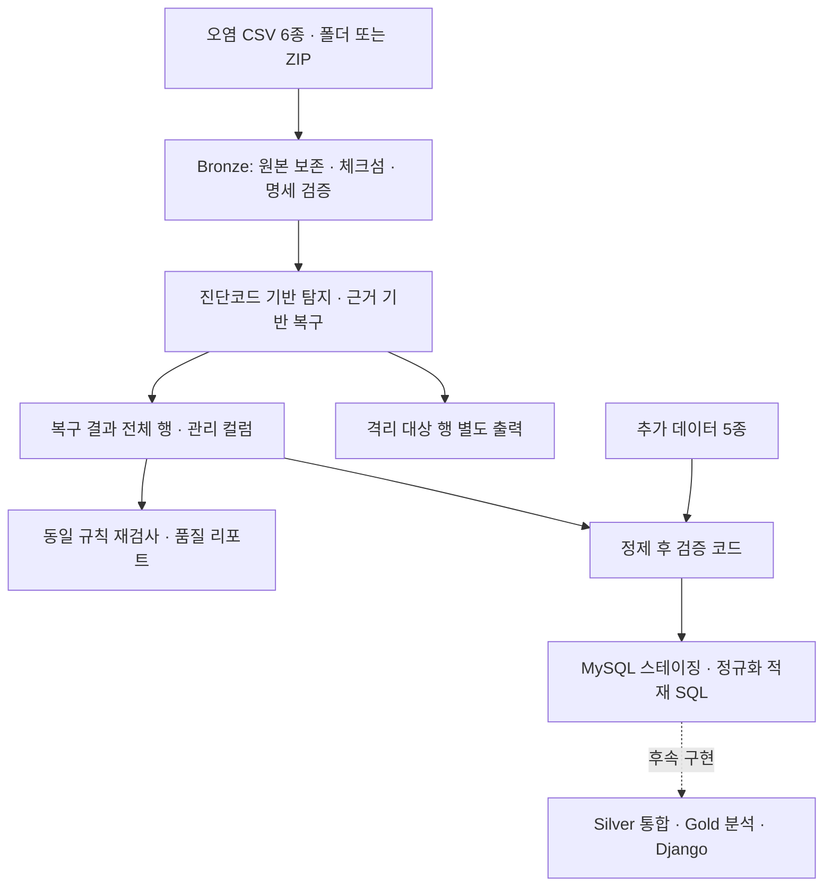

# F1 Team Builder Intelligence

F1 경기 데이터를 정제·분석해 드라이버와 팀의 특성을 파악하고, 드라이버 영입과 팀 운영 개선에 필요한 근거를 제시하는 프로젝트입니다.

이 문서는 **현재 저장소의 코드와 저장된 실행 결과**를 기준으로 진행 상황을 정리합니다. 전체 기획은 [F1_P2_Spec.md](./F1_P2_Spec.md)에 있습니다.

## 1. 데이터에서 출발한 분석 방향

### 분석의 출발점과 목적

출발점은 확보한 **세션·드라이버·랩·스틴트·기상·피트 데이터 6종과 출발 순위·경기 결과·주행 순위·경기 통제·격차 데이터 5종**입니다. 먼저 각 데이터의 범위와 품질을 확인하고, 연결 가능한 기록에서 어떤 차이와 패턴이 나타나는지 살펴봅니다.

분석은 **데이터 확인 → 정제·검증 → 탐색·비교 → 결과에 근거한 결론 도출 → 의미 해석**의 순서로 진행합니다. 개인 랩타임, 팀 동료 대비 페이스·일관성, 타이어 사용 특성, 피트 운영과 본경기 기본 포인트를 비교하되, 실제 데이터 커버리지와 비교 조건을 확인한 뒤 분석 질문과 결론의 범위를 구체화합니다.

드라이버 영입과 팀 운영은 분석 결과를 활용해 의미를 해석할 수 있는 영역입니다. 관찰된 차이가 팀의 보완점이나 후보 비교에 어떤 시사점을 주는지 검토하며, 성적과 팀 배분금·스폰서십 기회의 관계는 확보한 경기 데이터로 직접 확인할 수 있는 범위를 구분해 정성적으로 논의합니다.

### 데이터 구성과 현재 진행 범위

| 구분 | 데이터 | 진행 상태 |
|---|---|---|
| 오염 데이터 6종 | `sessions`, `drivers`, `laps`, `stints`, `weather`, `pit` | 진단·복구 파이프라인 구현 및 결과 생성 |
| 추가 데이터 5종 | `starting_grid`, `session_result`, `position`, `race_control`, `intervals` | [압축 파일](./data/f1_extra_data.zip) 확보, 검증·적재 코드 작성 |
| 표준화·검증 | 표준사전, 진단코드, 정제 후 검증 항목 | CSV 기준표와 pandas·SQL 검사 코드 작성 |
| DB 연계 | MySQL 스테이징·정규화 스키마·적재 SQL | 설계 및 스크립트 작성, 실제 DB 실행 결과는 별도 확인 필요 |
| 분석·서비스 | Gold 9개 마트, Django, 드라이버 비교·팀 추천 | 기획 및 HTML 화면 시안 작성, 최종 구현은 후속 단계 |

기획상 분석 범위는 **2023년부터 2026-10-14까지 종료된 본경기(Race)**입니다. 실제 수집 범위와 분석 가능 경기는 데이터 커버리지 검증으로 확정해야 합니다. Sprint·최속 랩 보너스를 제외한 본경기 기본 포인트를 사용하도록 정의했으며, 이를 공식 전체 챔피언십 포인트와 구분합니다.

### 추가 데이터로 분석의 정확성과 해석 근거 보완

경기 흐름과 최종 성적까지 설명을 하기위한 기본 데이터 6종으로 랩타임·타이어 사용·피트 기록은 확인할 수 있지만 한계가 있습니다. 이를 보완하기 위해 출발 순위·경기 중 순위·격차·경기 통제 상황·최종 결과를 담은 추가 데이터 5종을 확보했습니다. 기존 기록에 경기 상황과 결과를 연결해 더 정확한 비교와 해석이 가능하도록 분석 범위를 확장합니다.

| 추가 데이터 | 기존 데이터와 연결해 확인할 내용 | 분석에서 보완하는 점 |
|---|---|---|
| `starting_grid` | 출발 위치와 최종 순위의 차이 | 최종 순위와 함께 출발 조건을 고려해 성적 해석 |
| `session_result` | 최종 순위·완주 여부와 본경기 기본 포인트 | 랩 페이스에서 관찰한 차이를 실제 경기 결과와 대조 |
| `position` | 경기 중 순위 변화와 피트 전후 위치 | 피트 기록과 함께 경기 흐름을 확인해 전략 해석 보완 |
| `race_control` | 세이프티카·적기 등 경기 통제 시점과 랩·피트 기록 | 통제 구간을 구분해 주행 조건이 다른 기록의 단순 비교를 줄임 |
| `intervals` | 같은 시점의 선두·앞차와의 격차 | 랩타임·순위 변화에 격차 정보를 더해 경쟁 상황 해석 |

핵심은 **기존 데이터에서 발견한 차이에 추가 데이터로 경기 맥락과 결과를 연결하고, 그 근거를 바탕으로 결론의 정확성을 높이는 것**입니다. 예를 들어 긴 랩타임이 관찰되면 경기 통제 기록과 대조해 해당 구간을 비교에 포함할지 판단하고, 피트 전후 순위 변화는 같은 시점의 격차와 최종 성적을 함께 확인해 해석합니다.

예선의 출발 순위 데이터는 같은 대회의 본경기 세션에 매핑하고, 순위·격차·경기 통제 기록은 관측 시각을 기준으로 연결해야 합니다. 추가 데이터의 활용 효과는 이러한 연결의 정확성과 분석 가능한 범위를 검증한 뒤 판단합니다.  현재는 추가 데이터 확보와 검증·적재 코드 작성 단계이므로, 분석을 마친 뒤 실제 적용 범위와 보완 전후의 결과를 제시합니다.

## 2. 오염 데이터 유형 정리

진단코드는 [diagnostic_codes.csv](./data/standard_dictionary/diagnostic_codes.csv)에서 관리하며 파이프라인이 직접 읽습니다. `DQ001~DQ027` 중 `DQ012`는 비활성 코드이고, 미복구 결함은 원래 진단코드에 `OPEN` 상태로 기록합니다.

| 오염 유형 | 대표 사례 | 진단코드 | 처리 방향 |
|---|---|---|---|
| 결측 | 국가 코드, 섹터 시간, 랩타임, 타이어 종류·경계 누락 | DQ001~005, DQ008~009, DQ018, DQ024 | 동일 인물·인접 기록·계산식 근거로 복구하거나 원천 결측 유지 |
| 이상치 | 300초 초과 랩타임, 180초 초과 피트 시간, 10초 초과 정지시간 | DQ006~007, DQ022 | 경기 상황일 수 있으므로 자동 삭제하지 않고 검토 |
| 값 오류 | 스틴트 종료 범위 오류, 랩 시작 시각 불일치, 기상 측정값 오류 | DQ010, DQ019, DQ023 | 시간 순서·인접 측정값 등을 확인해 복구 또는 검토·격리 |
| 파일 내·파일 간 불일치 | 대회 키 불일치, 섹터 합계와 랩타임 차이, 피트 시간 컬럼 충돌 | DQ015, DQ020~021 | 교차 검증으로 복구하거나 검토·격리 |
| 값 뒤바뀜 | 드라이버 이름·약어 교환, 소속 팀 불일치 | DQ016~017 | 시즌 내 신원 합의값, 앞뒤 세션과 팀 색상으로 복구 |
| 구조·형식 오류 | 명세서와 다른 컬럼, 숫자·일시·허용 코드 해석 실패 | DQ013~014 | 파일 검토 또는 행 격리 |
| 참조 무결성 위반 | 최대 랩을 넘는 피트 기록, 상위 세션·드라이버 부재 | DQ025, DQ027 | 참조 관계를 확인하고 검토 또는 격리 |
| 중복·구간 중첩 | 자연키 중복, 실제 스틴트 구간 겹침 | DQ026, DQ011 | 중복은 격리, 중첩은 검토 |

**오염 유형과 처리 상태를 분리**합니다. 특이한 값이 모두 잘못된 값은 아니므로 1랩 시각·랩타임 결측, 속도 측정 결측, 빈 스틴트 등은 규칙에 따라 원천 특성으로 허용합니다. 스틴트의 같은 랩 경계 공유와 실제 구간 중첩도 구분합니다.

## 3. 데이터 표준사전 정의

서로 다른 파일에서 같은 의미의 데이터를 같은 이름·타입·단위·코드·검증 규칙으로 해석하기 위한 기준입니다. 원천 11종의 컬럼 정의와 정제·검증 기준을 [data/standard_dictionary](./data/standard_dictionary/README.md)에 모았습니다.

| 구성 | 파일 | 정의 내용 |
|---|---|---|
| 표준단어 | [standard_words.csv](./data/standard_dictionary/standard_words.csv) | 업무 개념을 구성하는 단어와 의미 |
| 표준용어 | [standard_terms.csv](./data/standard_dictionary/standard_terms.csv) | 단어 조합으로 만든 용어와 식별자 규칙 |
| 도메인 | [domains.csv](./data/standard_dictionary/domains.csv) | 타입·길이·단위·결측 허용·값 범위 |
| 코드 | [codes.csv](./data/standard_dictionary/codes.csv) | 허용 코드와 코드별 의미 |
| 컬럼사전 | [column_dictionary.csv](./data/standard_dictionary/column_dictionary.csv) | 파일·컬럼별 표준용어, 도메인, 검증 규칙 |
| 진단 기준 | [diagnostic_codes.csv](./data/standard_dictionary/diagnostic_codes.csv) | 오염 유형·심각도·탐지 조건·기본 조치 |
| 검증 기준 | [validation_checks.csv](./data/standard_dictionary/validation_checks.csv) | 정제 후 검사 VC01~VC71 |
| 배점 기준 | [race_points_rules.csv](./data/standard_dictionary/race_points_rules.csv) | 본경기 기본 포인트 계산 기준 |
| 조합 규칙 | [composition_rules.md](./data/standard_dictionary/composition_rules.md) | 명명·키·관계·복구 관리 규칙 |

통합 문서는 [표준사전 PDF](./data/standard_dictionary/F1_AI_data_standard_dictionary.pdf)로 확인할 수 있습니다.

### 주요 적용 기준

- 컬럼명은 `snake_case`, 식별자는 `_key`, 순번은 `_number`, 소요시간은 `_duration`으로 구분합니다.
- 세션 연결은 `session_key`, 드라이버 연결은 `session_key + driver_number`를 사용합니다. `meeting_key`와 `session_key`는 다른 개념입니다.
- 원본 값은 문자열로 보존하고 계산·검사할 때만 숫자·일시로 해석합니다. 빈 문자열을 임의로 0으로 바꾸지 않습니다.
- 시간 길이는 초, 기온·노면온도는 섭씨로 정의합니다. 날짜시간은 UTC 오프셋을 포함해 해석합니다.
- 타이어 코드는 `SOFT`, `MEDIUM`, `HARD`, `INTERMEDIATE`, `WET`, `UNKNOWN`으로 관리합니다. `UNKNOWN` 부여는 실제 종류 복원을 의미하지 않습니다.
- 드라이버 국가 코드와 개최국 코드를 구분하고, `segments_sector_1~3`은 목록 형태의 원문을 보존합니다.
- 격차는 숫자와 `+N LAP(S)` 표현을 구분하며, 예선 `starting_grid`와 Race 결과는 세션 매핑 후 연결합니다.
- `lane_duration`과 `stop_duration`을 분리해 피트레인 체류시간과 정지시간을 혼동하지 않습니다.

## 4. 데이터 정제 및 처리과정: 파이프라인 구성

### 전체 흐름



### ① 원본 보존과 구조 검증

입력은 [배포 폴더](./data/f1_recovery/F1_distribution/README.md) 또는 같은 구성의 ZIP입니다. `all_years/` 아래 CSV 6종을 문자열로 읽고 원본 파일은 수정하지 않습니다. 파일별 SHA-256, 인코딩, 행·컬럼 수, 컬럼 구성·순서를 배포 체크섬과 명세서에 대조해 `bronze_manifest.csv`에 기록합니다.

### ② 진단과 근거 기반 복구

[run_pipeline.py](./run_pipeline.py)가 결측·형식·키·관계·시간·구간 규칙을 검사하고 근거가 충분한 값만 수정합니다.

| 대상 | 복구 근거·방법 |
|---|---|
| 대회 식별자 | 같은 세션의 하위 5개 파일이 가리키는 합의값 |
| 드라이버 신원·팀 | 시즌 내 차량번호별 신원 합의값, 앞뒤 세션 소속팀과 팀 색상 |
| 국가 코드·프로필 URL | 같은 드라이버의 다른 세션 기록, 같은 시즌의 유일한 URL |
| 섹터 시간 | 한 섹터만 비었을 때 `랩타임 - 나머지 두 섹터 시간` |
| 랩타임·시작 시각 | 인접 랩의 시각 차이, 시각 교환·시간 연속성 |
| 타이어·스틴트 | 컴파운드 결측은 `UNKNOWN`, 경계는 인접 스틴트·랩 기록 |
| 기상 측정값 | 단일 튐값의 앞뒤 측정값 평균 |

중앙값 등으로 결측을 일괄 채우지 않습니다. 근거가 부족하면 `OPEN`, 원천 특성으로 허용하면 `ACCEPTED`, 복구가 끝나면 `REPAIRED`로 기록합니다. 분석을 왜곡할 수 있는 미해결 결함은 `quarantine_flag=Y`로 표시합니다.

### ③ 복구 이력·격리·재검증

`repaired/`에는 **격리 행을 포함한 전체 행**을 저장하고 `quarantine/`에는 격리 대상 행을 별도로 저장합니다. 분석할 때에는 `quarantine_flag=Y`를 제외해야 합니다.

복구 CSV에는 `original_*`, `repair_status`, `repair_method`, `repair_confidence`, `repair_reason`, `dq_codes`, `quarantine_flag`를 남깁니다. 이슈와 변경 이력은 `issue_id`로 연결하며 복구 후 같은 규칙으로 재검사한 잔여 건수도 기록합니다.

### ④ 정제 후 검증과 DB 적재 준비

[tools/validate_cleaned.py](./tools/validate_cleaned.py)와 [sql/03_validate_cleaned.sql](./sql/03_validate_cleaned.sql)은 VC01~VC71 기준으로 결측·중복·참조·범위·정합성·포인트·행 수 대사·JOIN 행 증폭을 검사하도록 작성했습니다. pandas 검증은 ERROR 위반이 있으면 종료 코드 1을 반환합니다.

MySQL 스크립트는 다음 순서로 구성했습니다. 현재는 스크립트가 준비된 상태이며 실제 DB 적재와 검증 통과 여부는 실행 결과로 확인해야 합니다.

| 순서 | 파일 | 역할 |
|---|---|---|
| 1 | [01_create_staging.sql](./sql/01_create_staging.sql) | 원문 문자열 스테이징·기준표 생성 |
| 2 | [02_load_staging.sql](./sql/02_load_staging.sql) | 정제 결과·추가 데이터·품질 이력 적재 |
| 3 | [03_validate_cleaned.sql](./sql/03_validate_cleaned.sql) | 정제 후 품질 검증 |
| 4 | [04_create_schema.sql](./sql/04_create_schema.sql) | 정규화 스키마·변환 함수·본경기 포인트 뷰 생성 |
| 5 | [05_insert_schema.sql](./sql/05_insert_schema.sql) | 업무 테이블 변환·적재·행 수 대사 |

설계는 [TO-BE 모델](./data/schema/TO_BE_model_design.md), 원천 정의는 [11종 데이터 명세서](./data/schema/F1_데이터_명세서.md)를 참고합니다.

### 실행 방법

```powershell
pip install -r requirements.txt
python run_pipeline.py --config config.json
python tools/validate_cleaned.py --extra data/f1_extra_data.zip
```

`config.json`의 기본 설정은 다음과 같습니다.

```json
{
  "input_path": "data/f1_recovery/F1_distribution",
  "output_directory": "outputs/f1_recovery"
}
```

결과·리포트 로직 테스트는 `python -m unittest discover -s tests -v`로 실행합니다. MySQL 적재는 추가 데이터 ZIP을 `data/f1_extra_data/`에 풀고 `sql/`의 01~05를 순서대로 실행합니다. CSV 적재에는 클라이언트·서버의 `local_infile` 설정이 필요합니다.

## 5. 데이터에서 확인한 결과와 의미 해석

### 현재 확인된 정제 결과

아래 수치는 저장된 [실행 요약](./outputs/f1_recovery/reports/run_result.json), [파일별 요약](./outputs/f1_recovery/reports/repair_summary.csv), [진단별 집계](./outputs/f1_recovery/reports/dq_summary.csv)를 기준으로 합니다. 파이프라인 버전은 `0.2.0`, 실행 ID는 `3d8d8eebc0fc`입니다.

| 지표 | 결과 |
|---|---:|
| 입력 데이터 | 6종, 총 120,873행 |
| 탐지된 품질 이슈 | 28,052건 |
| 자동 복구 | 1,335셀 |
| 원천 특성으로 허용 | 24,824건 |
| 미해결·검토 필요 | 1,893건 |
| 격리 대상 | 2행 |
| 원본 체크섬·명세 검증 | 6종 모두 일치 |

이슈 수는 행 수가 아닙니다. 한 행에서 여러 컬럼·규칙의 이슈가 발생할 수 있으며 격리 2행의 이슈는 미해결 건수에 포함됩니다.

| 데이터 | 입력 행 | 탐지 이슈 | 복구 셀 | 미해결 이슈 | 격리 행 |
|---|---:|---:|---:|---:|---:|
| sessions | 87 | 2 | 2 | 0 | 0 |
| drivers | 1,771 | 928 | 742 | 137 | 0 |
| laps | 97,018 | 26,814 | 527 | 1,523 | 0 |
| stints | 5,040 | 79 | 59 | 9 | 0 |
| weather | 13,928 | 5 | 5 | 0 | 0 |
| pit | 3,029 | 224 | 0 | 224 | 2 |

### 정제 결과에서 도출한 결론과 해석

현재 저장된 실행 결과로 확인할 수 있는 것은 데이터 품질과 복구 범위입니다. 이를 근거로 다음과 같이 결론을 도출하고, 후속 분석에 주는 의미를 해석합니다.

- **세션·드라이버 연결의 신뢰도 개선:** 대회 키 2셀, 드라이버 신원 20셀, 팀명 4셀을 복구했습니다. 경기·선수·팀을 잘못 연결하는 문제를 줄였습니다.
- **랩·섹터 분석용 값 복원:** 섹터 시간 489셀, 랩타임 2셀, 시작 시각 36셀을 복구했습니다. 다만 섹터 결측 1,000건과 랩타임 결측 261건 등이 미해결이므로 분석별 유효 표본을 확인해야 합니다.
- **타이어·기상 조건 정리:** 스틴트 경계 52셀, 컴파운드 7셀, 기상 측정값 5셀을 처리했습니다. 컴파운드 7셀은 실제 종류 추정이 아닌 `UNKNOWN` 표기입니다.
- **원천 결측과 복구 대상을 분리:** 속도 결측 24,101건은 대체하지 않고 허용했습니다. 속도 비교에는 측정값이 있는 표본을 사용하고 커버리지를 함께 제시해야 합니다.
- **피트 분석의 왜곡 방지:** 시간 컬럼이 충돌하는 2행을 격리했습니다. 장시간 피트 164건·정지시간 57건은 검토 대상으로 남겨 정상 피트 운영과 구분할 수 있게 했습니다.

이 결과에서 도출할 수 있는 결론은 **일부 연결 오류와 결측을 근거에 따라 복구했지만, 지표별로 분석에 사용할 수 있는 데이터의 범위가 다르다**는 것입니다. 따라서 후속 비교에서는 복구 건수 자체보다 유효 표본 수, 결측 비율, 제외 기준을 함께 확인해야 합니다. 현재 확보한 결과는 이러한 판단의 근거이며, 드라이버의 우열이나 특정 팀 전략의 효과에 대한 결론은 후속 분석에서 확인해야 합니다.

### 후속 분석: 관찰할 지표와 결과의 해석 방향

아래 항목은 앞으로 탐색할 분석 방향입니다. 지표를 집계한 뒤 차이의 크기와 경기 조건을 확인하고, 관찰된 결과가 뒷받침하는 범위에서 결론과 시사점을 정리합니다.

| 분석 영역 | 관찰할 데이터·지표 | 결과를 바탕으로 해석할 내용 | 현재 상태 |
|---|---|---|---|
| 드라이버 비교 | 유효 랩 페이스·일관성, 팀 동료 대비 차이, 비교 집단 백분위 | 비교 조건 안에서 나타나는 드라이버별 주행 특성과 차이 | 기획·정제 기반 준비 |
| 타이어 사용 | 컴파운드별 스틴트 길이, 타이어 사용에 따른 페이스 변화 | 타이어 사용 양상과 페이스 변화의 관계, 경기 조건에 따른 차이 | 경계 정제 완료, 통합·집계 후속 |
| 팀 피트 운영 | 경기당 피트 횟수, 레인 체류시간과 정지시간 분포 | 팀별 운영 양상과 시간 편차, 추가 검토가 필요한 기록 | 정제·격리 및 DB 스키마 준비 |
| 실제 성적 | 출발·최종 순위, 본경기 기본 포인트, 팀 간 격차 | 순위 변화와 포인트 분포에서 드러나는 경쟁 양상 | 추가 데이터·배점표·검증 코드·SQL 뷰 준비 |
| 결과의 활용 | 앞선 분석에서 확인한 드라이버·팀별 특성과 차이 | 후보 비교·팀 운영의 시사점과 적용 한계, 경제적 기회에 대한 정성적 논의 | 분석 결론 도출 후 검토, Gold·서비스 구현 후속 |

후속 결과는 **사용 데이터와 비교 조건 → 관찰된 패턴·수치 → 도출한 결론 → 의미와 한계** 순서로 기록합니다. 관찰된 관계를 인과관계나 영입 효과로 단정하지 않고, 차이가 뚜렷하지 않은 결과도 함께 남깁니다. 드라이버 순위·추천 결과·영입 효과에 대한 확정 수치는 아직 없으며, 화면 시안은 [design/index.html](./design/index.html)에 있습니다. 서비스에 반영할 내용도 실제 분석 결과를 확인한 뒤 구체화합니다.

### 산출물 위치

| 경로 | 내용 |
|---|---|
| [repaired/](./outputs/f1_recovery/repaired/) | 복구 CSV 6종 및 관리 컬럼 |
| [quarantine/](./outputs/f1_recovery/quarantine/) | 격리 대상 행 |
| [quality_report.html](./outputs/f1_recovery/reports/quality_report.html) | 구조 검증·파일별·진단별 결과 통합 리포트 |
| [validation_issues.csv](./outputs/f1_recovery/reports/validation_issues.csv) | 이슈별 코드·상태·근거 |
| [repair_detail.csv](./outputs/f1_recovery/reports/repair_detail.csv) | 변경 전후 값·방법·신뢰도 |
| [bronze_manifest.csv](./outputs/f1_recovery/reports/bronze_manifest.csv) | 원본 체크섬·행·컬럼 검증 |
| `outputs/f1_recovery/validation/` | 정제 후 검증 실행 시 생성되는 결과·샘플·결측 프로파일·행 수 대사 리포트 |
