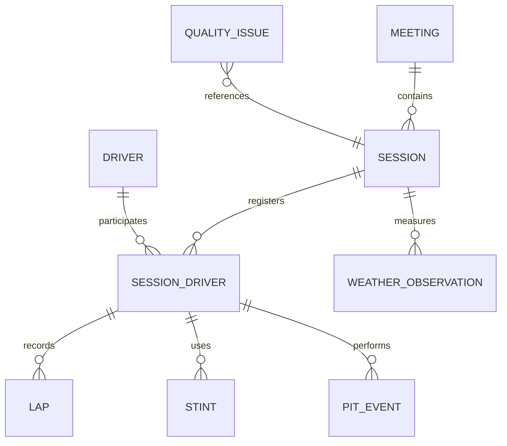
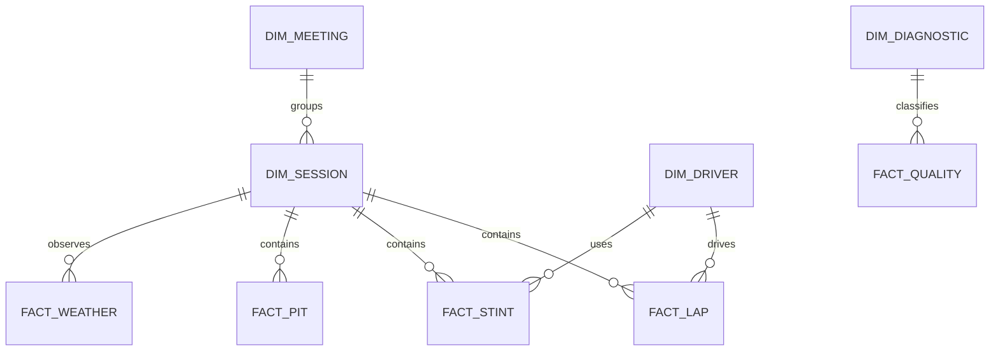

# F1 Delta Lake Medallion TO-BE 모델 설계도

## 1. 설계 범위

이 문서는 표준사전과 오염코드 진단 결과를 반영한 목표 데이터 모델 설계도다. 실제 테이블을 생성하지 않고, Delta Lake Medallion 구조와 최종 MySQL 물리 모델의 설계 기준만 정의한다.

```text
원본 CSV·명세서
      |
      v
Bronze Delta : 원본 보존, append-only, 재처리 기준
      |
      v
Silver Delta : 표준화, 타입 변환, 정규화, 품질 검증, 복구 이력
      |
      v
Gold Delta   : 분석·Django 조회 모델, 차원·사실·품질 요약
      |
      v
MySQL        : 서비스용 물리 테이블 또는 Gold 조회 모델 적재 대상
```

## 2. 레이어 설계 기준

| 레이어 | 저장 기술 | 역할 | 변환 원칙 | 테이블 성격 |
|---|---|---|---|---|
| Bronze | Delta Lake | 원본과 수집 이력 보존 | 값·컬럼·행을 임의 변경하지 않음 | 원본 복제 테이블 |
| Silver | Delta Lake | 표준사전 적용과 정합성 확보 | 타입 변환, 키 검증, 진단코드, 복구 메타데이터 기록 | 정규화 운영 테이블 |
| Gold | Delta Lake | 서비스·분석 제공 | 차원·사실·집계 모델로 목적별 최적화 | 조회·집계 테이블 |
| MySQL | MySQL 8.0+ | Django 서비스 제공 | Gold 또는 Silver의 승인된 모델 적재 | 물리 구현 대상 |

Bronze와 Silver는 원본 추적을 위해 `ingestion_id`, `source_file`, `source_row_key`, `ingested_at`을 유지한다. Silver의 값 변경은 `original_value`, `repair_status`, `repair_method`, `repair_confidence`, `repair_reason`, `diagnostic_code`로 추적한다.

## 3. 개념 모델 ERD

업무 객체는 대회, 세션, 세션 참가자, 랩, 스틴트, 피트 이벤트, 기상 관측으로 구성한다.



## 4. 논리 모델 ERD

Silver의 정규화 모델을 기준으로 한다. 드라이버 번호는 영구 개인 식별자가 아니므로 `DRIVER`의 단독 PK로 사용하지 않고, 세션 참가 관계에서 `session_key + driver_number`로 식별한다.

```mermaid
erDiagram
    SILVER_MEETING ||--o{ SILVER_SESSION : has
    SILVER_SESSION ||--o{ SILVER_SESSION_DRIVER : has
    SILVER_DRIVER ||--o{ SILVER_SESSION_DRIVER : enters
    SILVER_SESSION_DRIVER ||--o{ SILVER_LAP : has
    SILVER_SESSION_DRIVER ||--o{ SILVER_STINT : has
    SILVER_SESSION_DRIVER ||--o{ SILVER_PIT_EVENT : has
    SILVER_SESSION ||--o{ SILVER_WEATHER : has
    SILVER_SESSION ||--o{ SILVER_QUALITY_ISSUE : produces

    SILVER_MEETING { string meeting_key PK }
    SILVER_SESSION { string session_key PK; string meeting_key FK; string session_type_code FK }
    SILVER_DRIVER { bigint driver_id PK; string full_name }
    SILVER_SESSION_DRIVER { string session_key PK_FK; string driver_number PK_FK; bigint driver_id FK }
    SILVER_LAP { string session_key PK_FK; string driver_number PK_FK; integer lap_number PK }
    SILVER_STINT { string session_key PK_FK; string driver_number PK_FK; integer stint_number PK }
    SILVER_PIT_EVENT { string session_key PK_FK; string driver_number PK_FK; integer lap_number PK }
    SILVER_WEATHER { string session_key PK_FK; datetime observed_at PK }
    SILVER_QUALITY_ISSUE { bigint issue_id PK; string diagnostic_code FK }
```

## 5. Bronze 설계

Bronze는 정규화 대상이 아니라 원본 복구와 재처리를 위한 보존 계층이다. 모든 컬럼은 문자열 원문을 우선 보존하고, 원본 행을 삭제하거나 덮어쓰지 않는다.

| Bronze Delta 테이블 | 원천 | 주요 메타데이터 |
|---|---|---|
| `bronze_sessions` | sessions.csv | `ingestion_id`, `source_file`, `source_row_key`, `ingested_at` |
| `bronze_drivers` | drivers.csv | 동일 |
| `bronze_laps` | laps.csv | 동일 |
| `bronze_stints` | stints.csv | 동일 |
| `bronze_pit` | pit.csv | 동일 |
| `bronze_weather` | weather.csv | 동일 |

Bronze 파티션은 `year` 또는 `ingestion_date`를 우선 검토한다. `session_key`를 파티션으로 사용하면 작은 파일이 과도하게 생성될 수 있으므로 파티션 키로 고정하지 않는다.

## 6. Silver 논리 테이블

| Silver 테이블 | PK | 주요 FK | 표준사전 적용 |
|---|---|---|---|
| `silver_meeting` | `meeting_key` | - | IDENTIFIER, 국가·서킷 도메인 |
| `silver_session` | `session_key` | `meeting_key`, `session_type_code` | DATETIME_OFFSET, SESSION_TYPE |
| `silver_driver` | `driver_id` | - | 이름·국가 코드 도메인 |
| `silver_session_driver` | `session_key + driver_number` | `session_key`, `driver_id` | 세션 맥락 차량 번호 |
| `silver_lap` | `session_key + driver_number + lap_number` | `silver_session_driver` | 시간·속도·섹터 도메인 |
| `silver_stint` | `session_key + driver_number + stint_number` | `silver_session_driver`, `compound_code` | 컴파운드·경계 검증 |
| `silver_pit_event` | `session_key + driver_number + lap_number` | `silver_session_driver` | 피트 시간 도메인 |
| `silver_weather` | `session_key + observed_at` | `silver_session` | 온도·습도·풍향 도메인 |
| `silver_quality_issue` | `quality_issue_id` | `session_key`, `diagnostic_code` | DQ001~DQ012 |
| `silver_repair_detail` | `repair_detail_id` | `session_key` | 복구 전후·신뢰도 기록 |

## 7. Gold 설계

Gold는 분석과 Django 조회를 위해 중복을 허용할 수 있는 제공 모델이다. Silver의 정규화 모델을 직접 수정하지 않고 View 또는 Delta 테이블로 생성한다.



권장 Gold 모델:

- `dim_meeting`: 대회·국가·서킷 조회 차원
- `dim_session`: 세션 유형·시작/종료 시각 조회 차원
- `dim_driver`: 드라이버 표시 정보 차원
- `fact_lap`: 랩 시간·섹터·속도 사실
- `fact_stint`: 컴파운드·스틴트 구간 사실
- `fact_pit`: 피트 시간 사실
- `fact_weather`: 시각별 기상 사실
- `fact_quality`: 진단코드별 건수·복구상태 사실
- `dim_diagnostic`: DQ 코드·조건·기본 조치 차원

## 8. 정규화 기준

### 1NF

- Silver의 일반 속성은 원자값으로 저장한다.
- `segments_sector_1~3`은 원본 목록 문자열을 보존하되, 미니섹터 분석이 필요하면 `silver_lap_segment(session_key, driver_number, lap_number, sector_number, segment_number, status_code)`로 분해한다.

### 2NF

- 세션 참가자에만 의존하는 팀·프로필 정보는 `silver_session_driver`로 이동한다.
- 랩 속성은 랩 복합키 전체에 의존한다.
- 스틴트 속성은 스틴트 복합키 전체에 의존한다.

### 3NF

- 장소 정보는 `silver_meeting`, 세션 정보는 `silver_session`에만 둔다.
- 컴파운드·세션 유형·진단 상태는 코드 차원으로 관리한다.
- 복구 이력은 원천 사실 테이블과 `silver_repair_detail`로 분리한다.

Gold는 조회 성능을 위한 의도적 비정규화 영역이며, 정합성의 기준은 Silver다.

## 9. 식별키·관계 규칙

| 대상 | 식별키 | 관계 규칙 |
|---|---|---|
| 대회 | `meeting_key` | 여러 세션을 가진다. `session_key`와 동일 개념이 아니다. |
| 세션 | `session_key` | 모든 주행·기상 데이터의 기준 연결키다. |
| 세션 참가자 | `session_key + driver_number` | 드라이버 번호는 세션 맥락에서만 유일하다. |
| 랩 | `session_key + driver_number + lap_number` | 참가자 없는 랩을 허용하지 않는다. |
| 스틴트 | `session_key + driver_number + stint_number` | `lap_end >= lap_start`; 실제 중첩은 품질검증으로 탐지한다. |
| 피트 | `session_key + driver_number + lap_number` | 동일 랩 다중 피트가 필요하면 이벤트 순번을 추가한다. |
| 기상 | `session_key + observed_at` | 세션 시각별 하나의 관측값을 기본으로 한다. |

## 10. MySQL 물리 모델 설계 기준

실제 테이블을 생성하지 않고, 향후 MySQL 8.0+에 구현할 기준만 정의한다.

| 항목 | MySQL 설계 기준 |
|---|---|
| Bronze | `f1_bronze` 데이터베이스. 원본 컬럼과 적재 메타데이터를 문자열 중심으로 보존 |
| Silver | `f1_silver` 데이터베이스. `VARCHAR`, `DATETIME(6)`, `DECIMAL(12,6)`, `BOOLEAN` 사용 |
| Gold | `f1_gold` 데이터베이스. Django 조회용 차원·사실 테이블 또는 View |
| Quality | `f1_quality` 데이터베이스. 진단코드·복구 상세·실행 이력 |
| 키 | 문자열 업무키는 `VARCHAR(64)`, 내부 대체키는 `BIGINT AUTO_INCREMENT` |
| 인덱스 | 모든 FK, 복합 PK 선두 컬럼, 날짜 조회 컬럼에 인덱스 |
| 코드 제약 | MySQL 코드 테이블 FK 또는 `CHECK` 사용 |
| 시간 | 원본 오프셋을 변환·기록할 정책을 먼저 정하고 `DATETIME(6)`에 저장 |

권장 MySQL 테이블 명칭은 `f1_bronze.bronze_laps`, `f1_silver.silver_lap`, `f1_gold.fact_lap`처럼 레이어와 역할을 이름에 함께 표현한다.

## 11. 품질·진단 규칙

- `DQ001`: drivers.country_code 결측. 동일 세션 국가 코드 조인으로 복구 가능한 경우만 복구한다.
- `DQ003`, `DQ004`: 속도·섹터 수치 결측. 동일 세션·드라이버 중앙값을 우선 적용한다.
- `DQ006`, `DQ007`: 장시간 랩·피트. 자동 수정하지 않고 Silver 품질 이슈로 보존한다.
- `DQ008`: 컴파운드 결측. 실제 컴파운드를 추정하지 않고 `UNKNOWN`으로 기록한다.
- `DQ010`: `lap_end < lap_start`이면 오류다.
- `DQ011`: 다음 스틴트의 `lap_start < 이전 lap_end`이면 중첩 후보로 기록한다.
- Gold 집계는 `diagnostic_status`와 `repair_confidence`를 필터 조건으로 제공한다.

## 12. 구현 전 확인사항

1. Bronze Delta 테이블의 파티션과 보존 기간을 확정한다.
2. Silver에서 `driver_id` 대체키 발급 정책을 확정한다.
3. 동일 랩 다중 피트 이벤트가 존재하는지 확인한 후 `pit_event_number` 필요 여부를 결정한다.
4. 오프셋 포함 일시를 MySQL에 저장하는 표준 시간대를 확정한다.
5. Gold의 Django API 조회 패턴과 집계 주기를 확정한다.

이 문서는 설계도이며, 위 확인사항이 결정된 뒤 MySQL DDL과 Delta 적재 작업을 별도로 작성한다.
