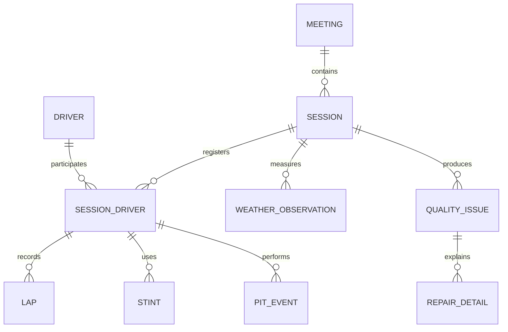
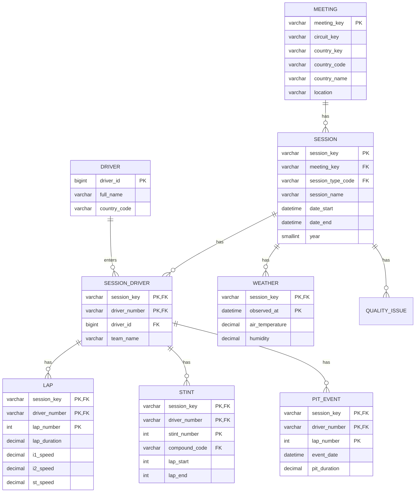

# F1 MySQL TO-BE 데이터베이스 설계도

## 1. 설계 목적

AS-IS 프로파일링 결과와 AI 데이터 표준사전을 적용해 F1 데이터를 MySQL 8.0+에서 관리하기 위한 목표 스키마를 정의한다. 이 문서는 DB 설계도이며, 실제 `CREATE TABLE` 실행은 별도 단계에서 진행한다.

설계 원칙:

- 원본 식별자와 코드값은 문자열 의미를 보존한다.
- `session_key`와 `meeting_key`를 구분한다.
- `driver_number`는 영구 드라이버 ID가 아니므로 세션 참가 맥락에서 식별한다.
- 장소 정보는 대회·세션 테이블에 두고 하위 사실 테이블에 중복 저장하지 않는다.
- 오염 진단과 복구 이력을 원천 업무 데이터와 분리한다.
- Gold 형태의 조회용 중복은 허용하되 정합성 기준은 정규화 모델로 한다.

## 2. 개념 ERD



업무 객체:

- `MEETING`: 대회, 개최지, 국가, 서킷
- `SESSION`: Race, Sprint, Qualifying, Practice 등 주행 세션
- `DRIVER`: 드라이버 기본 정보
- `SESSION_DRIVER`: 특정 세션의 참가자와 차량 번호
- `LAP`: 세션·드라이버별 랩 기록
- `STINT`: 세션·드라이버별 타이어 사용 구간
- `PIT_EVENT`: 세션·드라이버별 피트 이벤트
- `WEATHER_OBSERVATION`: 세션 시각별 기상 측정
- `QUALITY_ISSUE`: DQ 진단 결과
- `REPAIR_DETAIL`: 복구 전후 값과 근거

## 3. 논리 ERD



## 4. 테이블 및 식별키

| 테이블 | 업무 의미 | 기본키 | 주요 외래키 |
|---|---|---|---|
| `meeting` | 대회·개최지 | `meeting_key` | 없음 |
| `session` | 세션 | `session_key` | `meeting_key`, `session_type_code` |
| `driver` | 드라이버 마스터 | `driver_id` | 없음 |
| `session_driver` | 세션별 참가자 | `session_key + driver_number` | `session_key`, `driver_id` |
| `lap` | 랩 기록 | `session_key + driver_number + lap_number` | `session_driver` |
| `stint` | 타이어 스틴트 | `session_key + driver_number + stint_number` | `session_driver`, `compound_code` |
| `pit_event` | 피트 이벤트 | `session_key + driver_number + lap_number` | `session_driver` |
| `weather` | 기상 측정 | `session_key + observed_at` | `session_key` |
| `quality_issue` | 진단 결과 | `quality_issue_id` | `session_key`, `diagnostic_code` |
| `repair_detail` | 복구 이력 | `repair_detail_id` | `session_key`, `diagnostic_code` |

`driver_number`는 시즌·세션 간 재사용될 수 있으므로 `driver` 테이블의 단독 식별키로 사용하지 않는다. 화면과 사실 테이블에서는 반드시 `session_key + driver_number`를 함께 사용한다.

## 5. 물리 모델 정의

### 5.1 공통 타입 기준

| 표준 도메인 | MySQL 타입 | 길이·정밀도 | NULL | 적용 예 |
|---|---|---:|---|---|
| 식별자 | `VARCHAR` | 64 | N | `session_key`, `meeting_key` |
| 짧은 코드 | `VARCHAR` | 16~32 | Y/N | `compound_code`, `session_type_code` |
| 정수 문자열 | `VARCHAR` | 16 | Y | `driver_number`, `lap_number` 원문 |
| 정수 계산값 | `INT` | - | Y | `lap_number`, `lap_start`, `lap_end` |
| 시간 | `DATETIME(6)` | - | Y | `date_start`, `event_date` |
| 초 단위 실수 | `DECIMAL` | 12,6 | Y | `lap_duration`, `pit_duration` |
| 속도 | `DECIMAL` | 12,3 | Y | `i1_speed`, `st_speed` |
| 온도·기압 | `DECIMAL` | 12,3 | Y | `air_temperature`, `pressure` |
| 불리언 | `BOOLEAN` | - | Y | `is_cancelled`, `is_pit_out_lap` |
| 목록 원문 | `TEXT` | 가변 | Y | `segments_sector_1~3` |
| 설명 | `VARCHAR` | 1000 | Y | `repair_reason`, `issue_message` |

### 5.2 코드 테이블

| 코드 테이블 | 주요 코드 |
|---|---|
| `ref_compound` | `SOFT`, `MEDIUM`, `HARD`, `INTERMEDIATE`, `WET`, `UNKNOWN` |
| `ref_session_type` | `Race`, `Sprint`, `Qualifying`, `Practice` |
| `ref_diagnostic` | `DQ001`~`DQ027` (오류 유형·심각도 포함, `diagnostic_codes.csv`) |
| `ref_error_type` | `MISSING`, `INVALID`, `OUTLIER`, `INCONSISTENT`, `SWAP`, `SCHEMA`, `TYPE`, `REFERENTIAL`, `DUPLICATE`, `OVERLAP` |
| `ref_issue_action` | `AUTO_FIX`, `REVIEW`, `ACCEPT`, `QUARANTINE` |
| `ref_diagnostic_status` | `OPEN`, `REPAIRED`, `ACCEPTED`, `WAIVED` |
| `ref_repair_status` | `UNCHANGED`, `REPAIRED` |
| `ref_repair_confidence` | `HIGH`, `MEDIUM`, `LOW` |
| `ref_repair_method` | `codes.csv`의 `REPAIR_METHOD` 그룹 (중앙값 추정은 폐기) |

### 5.3 핵심 제약조건

```sql
-- MySQL 8.0 기준 설계 예시이며 실행 스크립트가 아님
CHECK (lap_start IS NULL OR lap_end IS NULL OR lap_end >= lap_start)
CHECK (lap_duration IS NULL OR lap_duration >= 0)
CHECK (pit_duration IS NULL OR pit_duration >= 0)
CHECK (humidity IS NULL OR humidity BETWEEN 0 AND 100)
CHECK (wind_direction IS NULL OR wind_direction BETWEEN 0 AND 360)
```

스틴트 중첩은 행 간 비교이므로 CHECK 제약만으로 처리하지 않고 검증 쿼리로 관리한다.

```sql
SELECT a.session_key, a.driver_number, a.stint_number, b.stint_number
FROM stint a
JOIN stint b
  ON a.session_key = b.session_key
 AND a.driver_number = b.driver_number
 AND a.stint_number < b.stint_number
WHERE a.lap_end IS NOT NULL
  AND b.lap_start IS NOT NULL
  AND b.lap_start < a.lap_end;
```

## 6. 정규화

### 1NF

- 반복되는 랩·스틴트·피트 데이터를 하나의 컬럼에 배열로 저장하지 않는다.
- `segments_sector_1~3`은 원본 호환을 위해 문자열로 보존하되, 미니 섹터 분석이 필요하면 `lap_segment`를 별도 테이블로 분리한다.

### 2NF

- 세션에 종속되는 장소 정보는 `meeting`, `session`에 둔다.
- 세션 참가자에 종속되는 팀·프로필 정보는 `session_driver`에 둔다.
- 랩 속성은 `session_key + driver_number + lap_number` 전체에 종속된다.
- 스틴트 속성은 `session_key + driver_number + stint_number` 전체에 종속된다.

### 3NF

- 코드값은 코드 테이블로 분리한다.
- 품질 진단과 복구 이력은 업무 사실 테이블에서 분리한다.
- 장소·세션·드라이버의 설명 속성을 랩·피트·기상 테이블에 중복 저장하지 않는다.

## 7. 관계 및 인덱스

- `session.meeting_key`에 인덱스를 둔다.
- `session_driver(session_key, driver_number)`를 유일키로 둔다.
- `lap(session_key, driver_number, lap_number)`를 기본키로 사용한다.
- `stint(session_key, driver_number, lap_start, lap_end)`에 구간 검색 인덱스를 둔다.
- `pit_event(session_key, driver_number, lap_number)`에 조회 인덱스를 둔다.
- `weather(session_key, observed_at)`를 기본키로 사용한다.
- `quality_issue(source_file, diagnostic_code, session_key)`에 복합 인덱스를 둔다.

## 8. 진단 결과 반영

- `DQ001`: `drivers.country_code` 결측
- `DQ003`: `laps.i1_speed`, `i2_speed`, `st_speed` 결측
- `DQ004`: 섹터 소요시간 결측
- `DQ006`: `lap_duration > 300`
- `DQ007`: `pit_duration > 180`
- `DQ008`: `stints.compound` 결측은 `UNKNOWN`
- `DQ009`: 스틴트 시작·종료 랩 결측
- `DQ010`: `lap_end < lap_start`
- `DQ011`: 스틴트 구간 중첩
- `DQ013`~`DQ027`: 구조·형식, 파일 간 `meeting_key` 불일치, 드라이버 신원·소속팀 뒤바뀜, 랩 시각 불일치, 섹터 합계, 피트 시간 충돌, 기상값 오류, 중복키, 참조 무결성 (전체 목록은 `diagnostic_codes.csv`)

모든 진단 이슈는 `quality_issue`에 기록하고, 복구가 발생한 행은 `repair_detail`에 원본값·복구값·방법·신뢰도·근거를 기록한다.

## 9. 구현 전 확정사항

1. MySQL 데이터베이스명과 운영·개발 환경을 확정한다.
2. `driver_id` 대체키 발급과 드라이버 동일인 통합 정책을 확정한다.
3. 동일 랩 다중 피트 이벤트가 있으면 `pit_event_number`를 복합키에 추가한다.
4. UTC 오프셋을 포함한 원본 일시를 MySQL에 저장하는 변환 정책을 확정한다.
5. 이 문서 확정 후 별도 단계에서 MySQL `CREATE TABLE` DDL을 작성한다.
