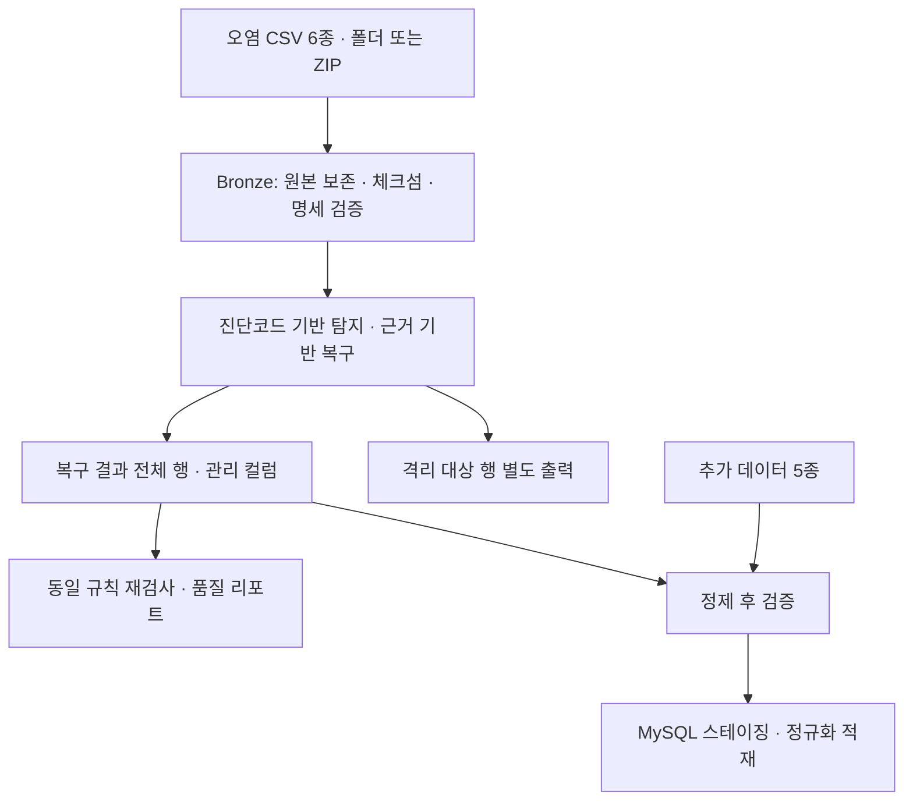

# 데이터 정제와 정제 후 데이터

[README.md](../README.md)의 「정제 후 데이터」 상세입니다. 실행 옵션과 출력 형식은 [pipeline/README.md](../pipeline/README.md)에 있습니다.

## 1. 처리 흐름



### ① 원본 보존과 구조 검증

입력은 [배포 폴더](../data/01_raw/F1_distribution.zip) 또는 같은 구성의 ZIP입니다. `all_years/` 아래 CSV 6종을 문자열로 읽고 원본 파일은 수정하지 않습니다. 파일별 행·컬럼 수, 컬럼 구성·순서, SHA-256 체크섬을 명세서와 배포 체크섬에 대조해 `bronze_manifest.csv`에 기록합니다.

### ② 진단과 근거 기반 복구

[pipeline/recovery.py](../pipeline/recovery.py)가 결측·형식·키·관계·시간·구간 규칙을 검사하고 근거가 충분한 값만 수정합니다.

| 대상 | 복구 근거·방법 |
|---|---|
| 대회 식별자 | 같은 세션의 하위 5개 파일이 가리키는 합의값 |
| 드라이버 신원·팀 | 시즌 내 차량번호별 신원 합의값, 앞뒤 세션 소속팀과 팀 색상 |
| 국가 코드·프로필 URL | 같은 드라이버의 다른 세션 기록, 같은 시즌의 유일한 URL |
| 섹터 시간 | 한 섹터만 비었을 때 `랩타임 - 나머지 두 섹터 시간` |
| 랩타임·시작 시각 | 인접 랩의 시각 차이, 시각 교환·시간 연속성 |
| 타이어·스틴트 | 컴파운드 결측은 `UNKNOWN`, 경계는 인접 스틴트·랩 기록 |
| 기상 측정값 | 단일 튐값의 앞뒤 측정값 평균 |

중앙값 등으로 결측을 일괄 채우지 않습니다. 근거가 부족하면 `OPEN`, 원천 특성으로 허용하면 `ACCEPTED`, 복구가 끝나면 `REPAIRED`로 기록합니다. 분석을 왜곡할 수 있는 미해결 결함은 `quarantine_flag=Y`로 표시합니다.

### ③ 복구 이력·격리·재검증

`repaired/`에는 **격리 행을 포함한 전체 행**을 저장하고 `quarantine/`에는 격리 대상 행을 별도로 저장합니다. 분석할 때에는 `quarantine_flag=Y`를 제외해야 합니다. 복구 CSV에는 `original_*`, `repair_status`, `repair_method`, `repair_confidence`, `repair_reason`, `dq_codes`, `quarantine_flag`를 남기고, 이슈와 변경 이력은 `issue_id`로 연결합니다. 복구 후 같은 규칙으로 재검사한 잔여 건수도 기록합니다.

## 2. 정제 결과

[실행 요약](../data/04_reports/quality/run_result.json), [파일별 요약](../data/04_reports/quality/repair_summary.csv), [진단별 집계](../data/04_reports/quality/dq_summary.csv) 기준입니다. 파이프라인 `0.2.0`, 실행 ID `3d8d8eebc0fc`.

| 지표 | 결과 |
|---|---:|
| 입력 데이터 | 6종, 총 120,873행 |
| 탐지된 품질 이슈 | 28,052건 |
| 자동 복구 | 1,335셀 |
| 원천 특성으로 허용 | 24,824건 |
| 미해결·검토 필요 | 1,893건 |
| 격리 대상 | 2행 |
| 원본 체크섬·명세 검증 | 6종 모두 일치 |

이슈 수는 행 수가 아닙니다. 한 행에서 여러 컬럼·규칙의 이슈가 발생할 수 있으며 격리 2행의 이슈는 미해결 건수에 포함됩니다.

| 데이터 | 입력 행 | 원본 유지 행 | 복구 행 | 격리 행 | 탐지 이슈 | 복구 셀 | 미해결 이슈 |
|---|---:|---:|---:|---:|---:|---:|---:|
| sessions | 87 | 85 | 2 | 0 | 2 | 2 | 0 |
| drivers | 1,771 | 1,047 | 724 | 0 | 928 | 742 | 137 |
| laps | 97,018 | 96,493 | 525 | 0 | 26,814 | 527 | 1,523 |
| stints | 5,040 | 5,004 | 36 | 0 | 79 | 59 | 9 |
| weather | 13,928 | 13,923 | 5 | 0 | 5 | 5 | 0 |
| pit | 3,029 | 3,027 | 0 | 2 | 224 | 0 | 224 |
| 합계 | 120,873 | 119,579 | 1,292 | 2 | 28,052 | 1,335 | 1,893 |

행은 삭제하지 않습니다. 따라서 `원본 유지 + 복구 + 격리 = 입력 행`이며, 이 대사는 [데이터 검증](./04_데이터검증.md)에서 다시 확인합니다.

## 3. 정제 결과에서 도출한 결론

- **세션·드라이버 연결의 신뢰도 개선:** 대회 키 2셀, 드라이버 신원 20셀, 팀명 4셀을 복구했습니다. 경기·선수·팀을 잘못 연결하는 문제를 줄였습니다.
- **랩·섹터 분석용 값 복원:** 섹터 시간 489셀, 랩타임 2셀, 시작 시각 36셀을 복구했습니다. 다만 섹터 결측 1,000건과 랩타임 결측 261건 등이 미해결이므로 분석별 유효 표본을 확인해야 합니다.
- **타이어·기상 조건 정리:** 스틴트 경계 52셀, 컴파운드 7셀, 기상 측정값 5셀을 처리했습니다. 컴파운드 7셀은 실제 종류 추정이 아닌 `UNKNOWN` 표기입니다.
- **원천 결측과 복구 대상을 분리:** 속도 결측 24,101건은 대체하지 않고 허용했습니다. 속도 비교에는 측정값이 있는 표본을 사용하고 커버리지를 함께 제시해야 합니다.
- **피트 분석의 왜곡 방지:** 시간 컬럼이 충돌하는 2행을 격리했습니다. 장시간 피트 164건·정지시간 57건은 검토 대상으로 남겨 정상 피트 운영과 구분할 수 있게 했습니다.

결론적으로 **일부 연결 오류와 결측을 근거에 따라 복구했지만, 지표별로 분석에 사용할 수 있는 데이터의 범위가 다릅니다.** 후속 비교에서는 복구 건수보다 유효 표본 수, 결측 비율, 제외 기준을 함께 확인해야 합니다.

## 4. 산출물과 실행

| 경로 | 내용 |
|---|---|
| [repaired/](../data/03_cleaned/repaired/) | 복구 CSV 6종 및 관리 컬럼 |
| [quarantine/](../data/03_cleaned/quarantine/) | 격리 대상 행 |
| [quality_report.md](../data/04_reports/quality/quality_report.md) | 구조 검증·파일별·진단별 결과 통합 리포트 (GitHub에서 표로 보임, 샘플 축약) |
| `quality_report.html` | 같은 리포트의 HTML판 (전체 샘플, 내려받아 브라우저로 열기) |
| [validation_issues.csv](../data/04_reports/quality/validation_issues.csv) | 이슈별 코드·상태·근거 |
| [repair_detail.csv](../data/04_reports/quality/repair_detail.csv) | 변경 전후 값·방법·신뢰도 |
| [bronze_manifest.csv](../data/04_reports/quality/bronze_manifest.csv) | 원본 체크섬·행·컬럼 검증 |

```powershell
pip install -r requirements.txt
python -m pipeline.recovery                       # 입력 data/01_raw/F1_distribution.zip → 출력 data/03_cleaned
python -m unittest discover -s tests -v           # 결과·리포트 로직 테스트
```
